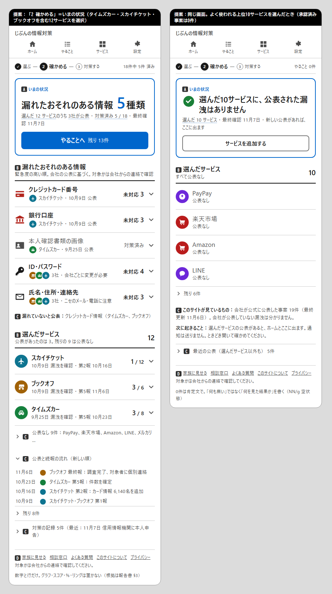

# ダッシュボード（いまの状況）— 調査報告と設計案（第6弾）

作成日：2026-11-07　前提：第1〜5弾（文字・絵・全体像・注意の4段階・重複排除）は維持する。本書は「ダッシュボードを追加したい」（開発者）に対し、何を・どこに・どう置くかを定める。
調査は3領域（ダッシュボードの定義と設計原則／消費者向けセキュリティ製品の実例／本サイトのデータで何が出せるか）を並行で行い、一次資料を優先した。確認できなかった点は「未確認」と明記する。

提案の見た目は [mockups/dashboard-proposal.png](mockups/dashboard-proposal.png)（左＝未対応がある状態、右＝公表なしの状態。A〜D の札は段の説明用で画面には出ない）。HTML版は [mockups/dashboard-proposal.html](mockups/dashboard-proposal.html)。

## 1. 結論（先に要点）

1. **ダッシュボードは、工程バーの「2 確かめる」の画面として置く**（ルート `#/status`、画面名「いまの状況」）。いま「確かめる」はホームに戻るだけで、3工程のうち専用画面が無い唯一の工程。ホームは「やること残数＋次の1件」（段A）のまま短く保ち、ダッシュボードは **「何が・どこから・いつ漏れたおそれがあり、何を済ませたか」** を1画面にまとめる。ヘッダーの4導線（ホーム／やること／サービス／設定）は変えない。入口は工程バーの「2」と、ホームの内訳行（「選んだサービス 12」「対策済み 5 / 18」）。
2. **中身は数字と行だけ。グラフは置かない。** 個人の数は「3社」「5種類」「5 / 18」のような1桁〜2桁の整数で、グラフが足す情報が無い（「1本の棒グラフより数字そのもの」）。NN/g は円・ドーナツ・ゲージを「ほとんどの場合避ける」とし、デジタル庁ガイドブックも表を「正確な数値の確認」向けと位置づける。既決の「進捗リング・％を置かない」とも整合する。
3. **構成は注意の4段階に従う。** A＝「漏れたおそれのある情報 **5** 種類」＋13pxの内訳1行（選んだ12サービスのうち3社が公表 ・ 対策済み 5 / 18 ・ 最終確認）＋主ボタン「やることへ 残り13件」。B＝**情報の種類別の行**（緊急度順、会社の丸、未対応数）と**選んだサービスの行**（公表あり3件は件数つき、公表なし9件は畳む）。C＝「漏れていないと公表」の1行、公表と続報の流れ（時系列）、対策の記録。D＝フッター。
4. **「公表なし」を肯定文で見せる。** よく使われる上位10サービス（PayPay、楽天市場、Amazon、LINE…）には承認済み事案が **0件**。多くの利用者にとって最初の答えは「選んだ10サービスに、公表された漏洩はありません」になる。いまはこの状態をホームの1行でしか言わず、どのサービスを見た結果かが分からない。空状態は「何も無い」ではなく「何を見た結果か」と次の導線を書く（NN/g 空状態、Mozilla Monitor「No exposures found」）。
5. **スコア・色の盾・％は使わない。** 継続利用中のスコアが行動を変える証拠は見つからなかった（研究はパスワード作成時の強度表示のみ）。Google の緑／黄／赤の盾は「一度赤になると消せない」と批判され、Monitor・1Password・Apple・Bitwarden はいずれも件数と文字で状態を示す。
6. **名前は「いまの状況」。** 「ダッシュボード」は非ITの社会人向けの画面名に使わない（工程名「確かめる」はそのまま）。
7. **家族（フェーズ2）の受け皿にする。** 同じ画面の上に「自分／母」の切り替えを足せる構造にしておく（本書では設計のみ、実装しない）。

## 2. 現状：「状況」はどこで分かるか

| 利用者の問い | いま分かる場所 | 問題 |
| --- | --- | --- |
| 何の情報が漏れたおそれがあるか（種類） | 事案別ページのチップだけ | 複数事案をまたいだ一覧が無い。「カードは1社、連絡先は3社」が見えない |
| どの会社から | ホーム「関係ある漏洩」（公表ありのみ） | — |
| 公表の無いサービスはどれか | どこにも無い | 「選んだ12のうち9は無事」が見えず、安心が得られない |
| 漏れていないと公表されたもの | 事案別ページの1行 | 横断で見えない（例の3社では2社が「カード情報は漏れていない」と明記） |
| いつ公表・続報があったか | 事案別ページの時系列 | 事案をまたいだ流れが無い（例の3社で公表は12回） |
| 何をいつ済ませたか | やることの「対策済み N件」（日付つき） | 時系列の記録として読めない |
| 最終確認はいつか | ホームの内訳行 | — |

例（タイムズカー・スカイチケット・ブックオフ）：漏れたおそれのある情報は **5種類**（クレジットカード番号＝1社、銀行口座＝1社、本人確認書類の画像＝1社、ID・パスワード＝3社、氏名・住所・連絡先＝3社）、公表は **12回**（9/25〜11/6）、やることは 18件。
一方、`popular_rank` 上位10サービスは承認済み事案 0件、サービスマスタ64件のうち事案があるのは23件。

## 3. 根拠の要約

### 3.1 定義と設計原則
- **Few（2004, Intelligent Enterprise）**：ダッシュボードは「目的の達成に必要な最重要情報を、1画面に集約し、一目で把握できるよう配置した視覚表示」。※原文PDFは取得したが文字抽出に失敗し、定義は広く引用される二次の文言。 https://www.perceptualedge.com/articles/ie/dashboard_confusion.pdf
- **Shneiderman（1996）**「Overview first, zoom and filter, then details-on-demand」。※同じく原文からの抽出は未確認。 https://www.cs.umd.edu/~ben/papers/Shneiderman1996eyes.pdf
- **NN/g Laubheimer 2017**：ダッシュボードは「1ページで一目で分かり、すぐ行動できる情報」で、「探索のためではない」。長さと2D位置（棒・折れ線）が速く正確、**円・ドーナツは「ほとんどの場合避ける」、ゲージは角度で伝えるため不得手で場所も取る**、色は量を伝えない（順序を感じない）。 https://www.nngroup.com/articles/dashboards-preattentive/
- **NN/g Kaplan 2021（空状態）**：「完全に空の状態を既定にしない」。処理が終わって何も無いなら「何も無い」と状態を文で示し、何が表示され得るか・どうすれば増えるかの導線を置く。 https://www.nngroup.com/articles/empty-state-interface-design/
- **デジタル庁「ダッシュボードデザインの実践ガイドブック」（2026-03-31版、2026-07-17更新）**：「全体から部分へ」「上から下へ、左から右へ」、全体を示す指標を先に置き詳細はあと。棒グラフの原点は0、色は1〜5色、3D・影などの装飾は使わない、表は「正確な数値の確認」向け、色だけに頼らず形・文字でも区別、データ表を併せて公開。設計は利用者の 5W1H（誰が・何のために）から始める。※本体PDFは10MB超で取得不可、代替テキスト版を参照。 https://digital.go.jp/resources/dashboard-guidebook
- **GOV.UK Summary list**：「鍵となる事実の一覧」に使い、「Last updated 22 June 2018」のようなメタ情報にも使う。作業の一覧には使わない（それは Task list）。 https://design-system.service.gov.uk/components/summary-list/
- **GOV.UK Complete multiple tasks**：状態は最小の種類から始める（Completed／Incomplete）。完了は「背景なしの黒文字」、赤背景はエラー以外に使わない。 https://design-system.service.gov.uk/patterns/complete-multiple-tasks/
- **dataviz（本セッションのデータ可視化指針）**：「見出しの数が数個 → 統計タイルの列」「1つの値 → 統計タイル。1本の棒グラフにしない」「部分対全体を数字の横で見せるなら、文字なしの細い分割バー」。円・ゲージ・2軸は禁止。

### 3.2 消費者向けセキュリティ製品のダッシュボード
| 製品 | 先頭に出すもの | 状態の分け方 | スコア | 全部済んだとき | 出典 |
| --- | --- | --- | --- | --- | --- |
| Mozilla Monitor | 「**N exposures**」（未解決の露出数）＋種類別の件数表（Exposure／Number）。「We found N exposures of your data. It appeared across M data breaches.」 | タブ「Action needed」「Fixed」 | 無し | 「Your data is protected」「All fixed here!」／0件は「No exposures found — We searched all known data breaches and found no exposures.」 | https://github.com/mozilla/blurts-server/blob/main/locales/en/dashboard.ftl |
| Google セキュリティ診断 | 盾のアイコン（緑＝問題なし、黄／赤＝要対応） | 項目を脅威度順 | 無し（色のみ） | 「A green shield with a check mark means your account is healthy」 | https://support.google.com/accounts/answer/46526 ／ https://www.blog.google/technology/safety-security/new-security-protections-tailored-you/ |
| 1Password Watchtower | 問題の種類ごとの区画（侵害サイト、使い回し、弱い…）。**空の区画は表示しない** | 区画＝問題の種類 | 無し | 明示の文言なし | https://support.1password.com/watchtower/ |
| Apple パスワード | 「Security」に弱い／漏洩したパスワードを列挙。提案は非表示にできる | 一覧 | 無し | 記載なし | https://support.apple.com/guide/passwords/recommendations-mchl506a0d14/mac |
| Bitwarden | レポートごとに1画面（Exposed／Reused／Weak／2FA…）。弱さの順に並べる | レポート別 | 無し | 記載なし | https://bitwarden.com/help/reports/ |
| HIBP（公開統計） | 大きな数字のタイル2つ「1,049 Total Breaches」「17.8B Pwned Addresses」 | — | 無し | — | https://haveibeenpwned.com/PwnedWebsites |

- 共通点：**先頭は件数か状態の文**、種類別・問題別の行、スコアや％は無い。Monitor の「種類別の件数表」と「N exposures across M breaches」が本サイトの A・B に最も近い。
- Google の盾は TechCrunch（2017）が「一度赤になると消せない」と批判。色だけの状態は「形＋色＋文字の3点セット」の既決にも反する。 https://techcrunch.com/2017/10/16/google-revamps-its-security-checkup-feature-with-personalized-suggestions-for-your-account/
- Dashlane の「Password Health score（0〜100）」は公式ページが404で未確認。

### 3.3 スコア・ゲーム化の証拠
- 見つかった研究は**パスワード作成時**の強度表示に限られる（IFIP 2019：232名でポイント式が強いパスワードを促した／CISPA：302名でバッジ・ハイスコア型メーターを比較。結果は未取得）。**継続利用中のスコアが対策の実行率を上げる証拠は見つからなかった。** https://dl.ifip.org/IFIP-AICT-557/hal-02365726 ／ https://cispa.de/en/research/publications/104982-bars-badges-and-high-scores-on-the-impact-of-password-strength-visualizations
- 本サイトは「責めない、脅さない」。点数は低いときに責める作用を持つ。採用しない。

### 3.4 本サイトのデータで出せるもの（追加のデータ項目は不要）
| 表示 | 計算元 |
| --- | --- |
| 漏れたおそれのある情報 N種類（種類別に会社・未対応数） | `rowsFor()` の行を `infoType` で集計。`limited_info_types` は除外（既決） |
| 選んだ N サービスのうち M社が公表 | `selected` × 事案の `service_ids` |
| 公表なしのサービス一覧 | `selected` − 事案のあるサービス |
| 漏れていないと公表 | 事案の `card_not_leaked_stated === true` |
| 公表と続報の流れ | 関係ある事案の `announcements[]` を日付順に結合（`title`／`changes` から1行） |
| 対策の記録 | `done` の完了日（`*:<カードID>`／`<事案ID>:<カードID>`）を日付順に |
| 最終確認 | `lastVisit` |
| このサイトが見ているもの N件・最終更新 | 公開JSONの事案数と `last_updated` の最大値 |

## 4. 設計案

### 4.1 置き場所と入口
- ルート `#/status`、タイトル「いまの状況｜じぶんの情報対策」。ヘッダーの4導線は変更しない。
- 工程バーの「2 確かめる」のリンク先をホーム（`#/`）から `#/status` に変える（全画面）。
- ホームの内訳行「選んだサービス 12」「対策済み 5 / 18」は `#/status` の該当セクションへ。「関係ある漏洩 3」はホーム内の行へ（現状どおり）。
- 未選択のときはホームと同じ空状態（「1 サービスを選ぶ」）に誘導する。

### 4.2 画面の構成（段A〜D）
| 段 | 要素 | 文言・値 |
| --- | --- | --- |
| B | 工程バー | 「選ぶ ✓ — **2 確かめる** — 対策する」右端「18件中 5件 済み」 |
| A | 状態の箱（1画面に1つ） | 小見出し「いまの状況」。見出し「漏れたおそれのある情報 **5** 種類」（数字44px青）。13px灰の1行「選んだ 12 サービスのうち 3社が公表 ・ 対策済み 5 / 18 ・ 最終確認 11月7日」（押せる）。主ボタン「やることへ 残り 13件」（未対応0なら枠線の「サービスを追加する」） |
| B | 漏れたおそれのある情報 | 見出し行（下罫線2px）＋補足「緊急度の高い順。会社の公表に基づく。対象かは会社からの連絡で確認」。行＝種類のアイコン（緊急度1は赤）＋種類名17px太字＋13px灰（会社の丸＋社名か「3社」＋公表日）＋右端「未対応 **3**」または灰の「対策済み」＋「›」→ やること画面の該当セクション |
| C | 漏れていないと公表 | 1行「漏れていないと公表：クレジットカード情報（タイムズカー、ブックオフ）」。該当が無ければ出さない |
| B | 選んだサービス | 見出し「選んだサービス **12**」＋補足「公表があったのは 3。残りの 9 は公表なし」。公表ありの行＝丸＋名前＋13px（公表日・状態・第N報）＋「2 / 11」。公表なしは `details`「公表なし 9件：PayPay、楽天市場…」（C） |
| C | 公表と続報の流れ | `details`。日付＋会社の丸＋1行（「ブックオフ 最終報：調査完了、対象者に個別連絡」）。新しい順、先頭4件、残りは「残り N件」 |
| C | 対策の記録 | `details`「対策の記録 5件（最近：11月7日 本人申告）」。開くと日付順の一覧 |
| D | フッター | 既存の文字リンク＋「対象かは会社からの連絡で確認してください」 |

- 公表なしの状態（右のモック）：A＝「選んだ10サービスに、公表された漏洩はありません」（✓緑のアイコン＋22px）＋13px「選んだ 10 サービス ・ 最終確認 ・ 新しい公表があれば、ここに出ます」＋枠線の「サービスを追加する」。B＝選んだサービスの行（灰、「公表なし」）を先頭4件＋「残り N件」。C＝「このサイトが見ているもの：会社が公式に公表した事案 19件（最終更新 11月6日）。会社が公表していない漏洩は分かりません」「次に起きること：…通知は送りません」＋「最近の公表（選んだサービス以外も）」。
- 全部済んだ状態：A の見出しは「漏れたおそれのある情報 5種類」のまま、主ボタンを枠線の「終わったやることを見る」に替え、種類の行はすべて灰の「対策済み」。再確認が出たら、その種類の行だけ「再確認 1」（△橙）。

### 4.3 書き方の規則
- 数は件数で。％・リング・バーは置かない（既決）。
- 「漏れた」と断定しない。見出しは「漏れたおそれのある情報」、補足に「会社の公表に基づく。対象かは会社からの連絡で確認」。
- 0件は肯定文（「公表された漏洩はありません」）。空の区画は出さない（1Password）。
- 色は既決どおり：青＝Aの枠・主ボタン・リンク、赤＝緊急度1の種類アイコン、橙＝再確認、灰＝対策済み・公表なし。

### 4.4 やらないこと・後回し
- **グラフ**（種類別の棒、月別の推移、進捗バー）：個人の数が小さく、情報が増えない。サイト全体の統計（月別の事案数など）は「じぶんの」状況ではなく、不安を煽る数字になりやすいので置かない。必要なら「すべての事案」ページに「掲載 N件 ・ 最終更新」の1行だけを検討する。
- **スコア・色の盾**：§3.2〜3.3 のとおり。
- **ヘッダーの入れ替え**（設定をフッターに下げ、ヘッダーを「ホーム／選ぶ／確かめる／対策する」にする案）：工程バーと重複する。工程バーが入口として機能しない場合の次善策として残す。
- **家族の切り替え**：フェーズ2で、この画面の上に「自分／母」のタブを足す。データは端末内の別キー。

## 5. 既存設計との整合
- CLAUDE.md「画面設計」：4画面（ホーム／やること／サービス／設定）は維持し、「確かめる」の画面として `#/status` を追記。工程バーの「2」のリンク先を変更。
- 注意の4段階：A の箱は1画面に1つ（この画面では「漏れたおそれのある情報 N種類」）。ホームの A（やること N件）とは数字が違い、役割も違う（ホーム＝次の行動、状況＝何が起きているか）。
- 重複排除（第5弾）：種類別の未対応数は `rowsFor()` の once 行と service 行をそのまま集計する。新しいデータ項目は要らない。
- 文体：画面名は「いまの状況」。「露出」「エクスポージャー」は使わない。

## 6. 実装計画（目安）

| 段階 | 内容 |
| --- | --- |
| 1 | app.js：`viewStatus()` を追加（A の箱、種類別の行、選んだサービスの行、漏れていないと公表、公表の流れ、対策の記録）。`summary()` に種類別集計と「公表なしのサービス」を足す |
| 2 | 工程バーの「2」を `#/status` に。ホームの内訳行のリンク先を変更。`TITLES`・`VIEWS` に追加 |
| 3 | app.css：既存の `.hero`／`.inc-rows`／`.fold-c`／`.task-row` を流用。新規は種類アイコンの行と時系列の一覧だけ |
| 4 | ライト／ダーク確認、CLAUDE.md の画面設計を更新 |

1本の PR の規模。データ・スキーマ・ビルドの変更は無い。

## 7. 未検証・判断が必要な事項
- A の数字を「種類の数（5種類）」にするか「公表した会社の数（3社）」にするか。本書は、ホーム（やること件数）・やること画面（残り件数）と違う軸で「何が」を示す種類の数を採った。
- 「公表と続報の流れ」の1行の文言は `announcements[].title` を短くするか、`changes` から生成するかを実装時に決める。
- 「対策の記録」に「再確認で戻った」履歴も載せるか（いまは完了日だけを保存している）。
- Few・Shneiderman の原文、デジタル庁ガイドブックの本体PDF、Dashlane のスコアは未確認。結論には影響しない。

## 8. 出典（主要）
- NN/g Dashboards（Laubheimer 2017）：https://www.nngroup.com/articles/dashboards-preattentive/ ／ Empty States（Kaplan 2021）：https://www.nngroup.com/articles/empty-state-interface-design/
- デジタル庁 ダッシュボードデザインの実践ガイドブック：https://digital.go.jp/resources/dashboard-guidebook ／ 事例集：https://www.digital.go.jp/resources/dashboard-case-studies
- Few, Dashboard Confusion（2004）：https://www.perceptualedge.com/articles/ie/dashboard_confusion.pdf ／ Shneiderman 1996：https://www.cs.umd.edu/~ben/papers/Shneiderman1996eyes.pdf
- GOV.UK Summary list：https://design-system.service.gov.uk/components/summary-list/ ／ Complete multiple tasks：https://design-system.service.gov.uk/patterns/complete-multiple-tasks/
- Mozilla Monitor ロケール（dashboard.ftl／exposure-card.ftl）：https://github.com/mozilla/blurts-server/tree/main/locales/en
- Google セキュリティ診断：https://support.google.com/accounts/answer/46526 ／ Google ブログ 2017：https://www.blog.google/technology/safety-security/new-security-protections-tailored-you/ ／ TechCrunch 2017：https://techcrunch.com/2017/10/16/google-revamps-its-security-checkup-feature-with-personalized-suggestions-for-your-account/
- 1Password Watchtower：https://support.1password.com/watchtower/ ／ Apple パスワード（Security）：https://support.apple.com/guide/passwords/recommendations-mchl506a0d14/mac ／ Bitwarden Reports：https://bitwarden.com/help/reports/ ／ HIBP：https://haveibeenpwned.com/PwnedWebsites
- ゲーム化の研究：https://dl.ifip.org/IFIP-AICT-557/hal-02365726 ／ https://cispa.de/en/research/publications/104982-bars-badges-and-high-scores-on-the-impact-of-password-strength-visualizations
