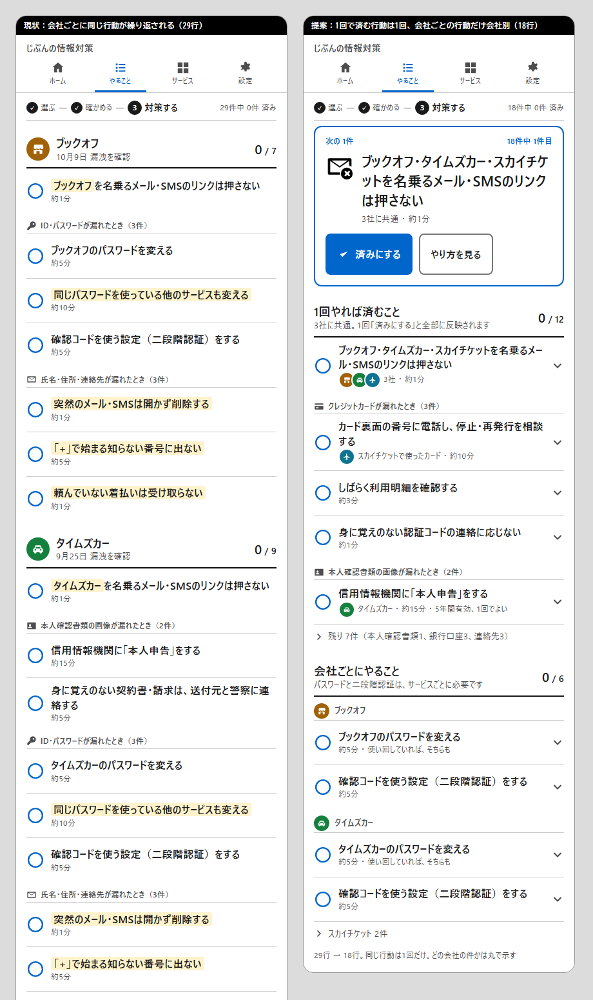

# 同じ行動の繰り返しをなくす — 調査報告と設計案（第5弾）

作成日：2026-11-07　前提：第1〜4弾（文字・絵・全体像・注意の4段階）は維持する。本書は「複数の事案で同じ行動が会社ごとに繰り返される」問題の解き方を定める。
きっかけは開発者の指摘「対策方法が各社で同じような方法が複数あって、冗長的に表示される」。
調査は2領域（製品の実例／行動別に束ねる根拠）を並行で行い、一次資料を優先した。確認できなかった点は「未確認」と明記する。

提案の見た目は [mockups/dedupe-proposal.png](mockups/dedupe-proposal.png)（左＝現状、右＝提案）。HTML版は [mockups/dedupe-proposal.html](mockups/dedupe-proposal.html)。

## 1. 結論（先に要点）

1. **重複は実測で大きい。** 承認済み19事案のうち、連絡先系の3行動（突然のメールは開かない／「+」の番号に出ない／着払いを受け取らない）と先頭カードは**全19事案**に、パスワード系の3行動は12事案に出る。事案を3つ選ぶと行数はユニークな行動数の**平均2.4倍**に膨らむ（例：タイムズカー・スカイチケット・ブックオフ＝29行、違う行動は15）。
2. **行動を「1回やれば済むこと」と「会社ごとに必要なこと」に分け、前者は1回だけ出す。** 会社ごとに必要なのは**パスワードの変更と二段階認証の2つだけ**。それ以外（ニセメール、カード会社への連絡、明細の確認、本人申告、国際電話の停止、着払い…）は1回やれば全社に効く。Mozilla Monitor（高リスク種別は種別ごとに1画面、完了も種別単位で一括）、FTC・IPA・NCSC（情報の種類で分岐し、汎用の注意は1回）と同じ構造。
3. **「使い回しパスワードも変える」は独立の行にしない。** パスワード変更の手順の末尾に「使い回していれば、そちらも」と付記する（Mozilla、HIBP、FTC、NCSC、IPA の全てがこの形）。
4. **出所（どの会社の件か）は行の補足に小さく残す。** 1行に会社の丸を並べ、「3社 ・ 約1分」のように書く（iOS／Android の通知グループは件数＋重複排除した名前で要約する）。会社名が題名に入る行動（ニセメール）は「A・B・Cを名乗る…」と連名にする。
5. **完了は「行動」単位で1回。** 共通の行を済みにすると全社に反映する（Mozilla の bulk-resolve と同じ）。新しい事案が加わったとき、再確認に戻すかは行動ごとに決める（本人申告は5年有効なので戻さない、カードの明細確認は戻す）。
6. **並びは「種類の緊急度」で、会社別の行はその中で会社ごとに束ねる。** GOV.UK タスクリストの「関連する作業を1タスクにまとめ、見出し付きの複数リストに分ける」に従い、「1回やれば済むこと」「会社ごとにやること」の2リストにする。
7. **慣れ（habituation）を避ける。** 同じ警告の2回目で脳の反応は「劇的に」落ち（Anderson 2015）、頻度の高い警告ほど速く読み飛ばされる（Akhawe & Felt 2013）。NIST は「ユーザーが下す決定の数を減らす」ことを推奨。繰り返しを消すこと自体が安全性を上げる。

## 2. 現状の実測（承認済み19事案、取り下げ除く）

| カード | 含む事案数 | 性質 |
| --- | --- | --- |
| 名乗るメール・SMSのリンクは押さない（先頭カード） | 19 | 1回（会社名を連名に） |
| 突然のメール・SMSは開かず削除 ／ 「+」の番号に出ない ／ 着払いを受け取らない | 19 | 1回 |
| パスワードを変える ／ 使い回しも変える ／ 二段階認証 | 12 | 会社ごと（使い回しは手順に吸収） |
| カード会社に電話 ／ 明細を確認 ／ 認証コードに応じない | 1 | 1回（カード単位。会社名を補足に） |
| 銀行に連絡 ／ ネットバンキングのパスワード ／ 入出金を確認 | 1 | 1回（銀行単位） |
| 本人申告 ／ 身に覚えのない契約書 | 1 | 1回（本人申告は機関ごとに1回、5年有効） |

- 2事案を選んだときの「行数／ユニーク行動数」は平均 **1.73**、3事案で **2.40**。
- 例（タイムズカー・スカイチケット・ブックオフ）：29行 → 提案では **18行**（先頭1＋カード3＋本人確認2＋銀行3＋連絡先3＋会社ごと2×3）。

## 3. 根拠の要約

### 3.1 製品はどう束ねているか
- **Mozilla Monitor**：修正フローは「高リスク（カード・SSN・口座）」「漏えいパスワード」「推奨事項（電話・メール・IP）」の3区画。高リスクと推奨事項は**データ種別ごとに1画面**で、根拠として事案名と日付を並べる。「Mark as fixed」はその種別を含む**全事案を同時に解決**（`bulk-resolve`）。パスワードだけは**事案ごとに1件ずつ順送り**で、手順2に「他で使っていればそこも変える」を固定で付ける。 https://github.com/mozilla/blurts-server/tree/main/locales/en
- **HIBP**：事案ページ末尾に汎用2項目（パスワード変更＋2FA）を固定表示。事案別に書き分けない。 https://haveibeenpwned.com/FAQs
- **Google セキュリティ診断**：6領域に集約し、2段階認証は1項目。**Apple パスワード**：アカウントごとの行だが由来事案は出さない。 https://support.google.com/accounts/answer/46526
- **1Password Watchtower**：使い回しは「同じパスワードを共有する項目のグループ」で表示。**Dashlane**：1つの漏洩から同じ・似たパスワードの他アカウントを同じ塊に入れる。 https://support.1password.com/watchtower/
- **FTC IdentityTheft.gov**：情報の種類で分岐。fraud alert は「1社に連絡すれば3社に伝わる」1回、credit freeze と本人申告は機関ごとに1回。相手ごとに繰り返すのは「口座が作られた会社に電話」「そのアカウントのパスワード変更」だけ。 https://www.bulkorder.ftc.gov/system/files/publications/501a_idt_a_recovery_plan_508.pdf
- **IPA（2026-10-26）**：事案別ではなく情報種別で分岐し、「日頃の対策」を全員向けに1回。 https://www.ipa.go.jp/security/anshin/attention/2026/mgdayori20261026.html
- **JICC／CIC**：本人申告は1人1コメント、**登録日から5年**。複数事案で複数回登録する枠組みはない。 https://www.jicc.co.jp/comment

### 3.2 束ね方の根拠
- **NN/g「Audience-Based Navigation」**：内容そのものでない軸（属性・出所）で分けると同じ内容が複数区画に重複し、利用者は区画を行き来して確かめる手間を負う。 https://www.nngroup.com/articles/audience-based-navigation/
- **GOV.UK タスクリスト**：関連する作業を1タスクに束ね、動詞で名付け、**見出し付きの複数リストに分ける**。単一の長いリストは「順序と並行可能性」を混乱させ、番号付きセクションにすると走査が速くなった（3サービス・34人・5ラウンド）。 https://design-system.service.gov.uk/patterns/complete-multiple-tasks/ ／ https://designnotes.blog.gov.uk/2017/04/04/weve-published-the-task-list-pattern
- **チェックリスト研究**：項目は系統ごとの塊に分け、**重複は避ける**。重要項目は先頭へ（Degani & Wiener、Flight Safety Foundation 解説）。 https://flightsafety.org/asw-article/making-a-list/
- **Asana「Merge Duplicate Tasks」**：重複は元タスクへ統合し、重複側は「duplicate」として完了＋元へのリンクを残す。 https://asana.com/inside-asana/mergetasks
- **文化審議会「公用文作成の考え方」**：「回りくどい言い方や不要な繰り返しはしない。強調したい言葉であってもむやみに繰り返さない」。 https://www.bunka.go.jp/seisaku/bunkashingikai/kokugo/hokoku/pdf/93731901_01.pdf

### 3.3 繰り返しの害
- **Anderson ら 2015（CHI, fMRI）**：同じ警告の**2回目の提示で視覚処理の活動が劇的に低下**し、以降さらに下がる。 https://scholarsarchive.byu.edu/facpub/9306
- **Akhawe & Felt 2013（USENIX）**：2,540万件の警告で、**頻度の高い警告ほど速く・多くクリックスルー**される（49%が1.7秒以内）。設計者は「警告を出す回数」を考慮すべき。 https://www.usenix.org/system/files/conference/usenixsecurity13/sec13-paper_akhawe.pdf
- **NIST「Security Fatigue」2016**：40人の過半数が「圧倒され、浴びせられている」。推奨は「決定の数を減らす」「正しい行動を簡単にする」。 https://www.nist.gov/news-events/news/2016/10/security-fatigue-can-cause-computer-users-feel-hopeless-and-act-recklessly

### 3.4 1項目・複数出所の見せ方
- **iOS 通知**：「同じ事柄について複数の通知を送らない」。グループの要約は**件数＋重複排除した名前**（「%u more messages from %@」）。 https://developer.apple.com/design/human-interface-guidelines/notifications.md
- **Android 通知グループ**：子が単独で完結し固有の操作を持つときだけグループにする。そうでなければ既存通知を更新する。 https://developer.android.com/develop/ui/views/notifications/group
- **Atlassian Badge**：件数は「文脈なしで使わない」（何を数えているかラベルで示す）。 https://atlassian.design/components/badge/usage
- **Sentry**：解決済みに新しい出来事が来ると「Regressed」として戻る＝「新しい出所で再び開く」の明示モデル。 https://docs.sentry.io/product/issues/states-triage/

## 4. 設計案

### 4.1 カードに「範囲」を持たせる（data/cards.json）
| 項目 | 値 | 意味 |
| --- | --- | --- |
| `scope` | `"once"`（既定）／`"service"` | once＝1回やれば全事案に効く。service＝事案（サービス）ごとに1行 |
| `renew_on_new_incident` | true／false | once の行を済みにしたあと、同じ種類の情報を含む**新しい事案**が加わったら「再確認」に戻すか |
| `title` | `{services}` を使える | once で会社名を連名にする（「{services}を名乗るメール…」） |

割り当て：
- `service`：`cred-change-password`、`cred-enable-2fa`
- `once`・戻す：`card-call-issuer`、`card-check-statement`、`card-ignore-auth`、`bank-contact`、`bank-change-password`、`bank-check-history`、`mynumber-*`
- `once`・戻さない：`first-no-links`（会社名の連名を更新するだけ）、`contact-*`、`iddoc-self-declare`（5年有効）、`iddoc-unknown-contract`、`assets-*`、`medical-*`
- `cred-change-reused` は削除し、`cred-change-password` の手順3「同じパスワードを他で使っていれば、そちらも変える」に吸収（根拠は統合）

### 4.2 やること画面の構造
1. **次の1件**（段A）：そのまま。共通の行なら「3社に共通 ・ 約1分」。
2. **「1回やれば済むこと」**（段B の見出し行）：補足「3社に共通。1回「済みにする」と全部に反映されます」。中は情報種別の緊急度順に、種別の小見出し（「クレジットカードが漏れたとき（3件）」）＋行。各行の補足に**会社の丸（最大3つ）＋「3社」または会社名**＋所要時間。先頭3件を見せて「残り N件（種別の内訳）」に畳む。
3. **「会社ごとにやること」**（段B の見出し行）：補足「パスワードと二段階認証は、サービスごとに必要です」。会社ごとの小見出し（丸＋名前）＋2行。会社が4つ以上なら4社目以降を「○○ 2件」で畳む。
4. 対策済みは各リストの末尾に「対策済み N件」で畳む（第4弾と同じ）。
5. ホームの「関係ある漏洩」の行はこれまでどおり会社ごと。件数はその会社に関係する行の数（共通の行は各社に数える。済みにすると全社の件数が同時に減る）。

### 4.3 完了状態（localStorage）
- 保存キー：`service` の行は従来どおり `事案ID:カードID`。`once` の行は `*:カードID`。
- 移行：既存の `事案ID:カードID` が1つでも済みなら `*:カードID` を済みとみなし、最も新しい完了日を採る（次回保存時に書き換える）。
- 再確認：`once` の行の「戻す日」＝関係する事案のうち、`renew_on_new_incident` が true のカードについて「その事案の初公表日・情報追加日」の最大。完了日より新しければ「再確認」（補足に「○○が加わりました」）。false のカードは戻さない。
- 引き継ぎコードは完了キーをそのまま含むので互換。

### 4.4 事案別ページ（静的）
- 1事案だけを見るページなので、重複は起きない。構造は変えず、`cred-change-reused` の削除と手順3の追加だけ反映する。

## 5. 既存設計との整合
- 第1弾「1カード1行動」「先頭は必ずニセメール」：維持。先頭カードは連名になる。
- 第3弾「目次」「次の1件」：維持。目次は「1回やれば済むこと／会社ごと」の2見出しで十分なので、事案4つ以上でも出さない方向で簡略化できる（実装時に判断）。
- 第4弾「注意の4段階」：見出し行は段B（下罫線2px）、会社の小見出しと補足は段C。
- データスキーマ（docs/data-schema.md）に `scope` と `renew_on_new_incident` を追記。`validate.mjs` で値を検査。

## 6. 実装計画（目安）

| 段階 | 内容 |
| --- | --- |
| 1 | cards.json：`scope`／`renew_on_new_incident` を付与、`cred-change-reused` を手順に吸収、`{services}` 連名。schema と validate を更新 |
| 2 | app.js：行の生成を「事案×カード」から「行動（once は1つ、service は事案ごと）」に変更。完了キーの移行、再確認の判定 |
| 3 | やること画面：2リスト構造、会社の丸の連記、折りたたみ。ホームの件数の再計算 |
| 4 | build.mjs（事案別ページ）、ライト／ダーク確認、CLAUDE.md の更新 |

1本の PR の規模。

## 7. 未検証・判断が必要な事項
- 「1回やれば済むこと」を先に置くか「会社ごと」を先に置くか。緊急度1の情報（カード・本人確認書類・口座）は共通側に入るので、共通を先にした。会社ごとの行動（パスワード）は緊急度2。
- カード会社への電話は「カード単位」で、同じカードを複数のサービスで使っていれば1回で済むが、別のカードなら複数回必要。本サイトはカードを預からないので「○○で使ったカード」と会社名を列挙して利用者の判断に委ねる。
- `first-no-links` の連名が長くなる（5社以上）場合の表記（「ブックオフなど5社」）は実装時に決める。
- 再確認に戻す／戻さないの割り当ては本書の判断。公開後に利用者の声で見直す。

## 8. 出典（主要）
- Mozilla Monitor ロケール：https://github.com/mozilla/blurts-server/tree/main/locales/en ／ bulk-resolve：https://github.com/mozilla/blurts-server/blob/main/src/app/api/v1/user/breaches/bulk-resolve/route.ts
- HIBP FAQ：https://haveibeenpwned.com/FAQs ／ Google パスワード チェックアップ：https://support.google.com/accounts/answer/9457609 ／ Google セキュリティ診断：https://support.google.com/accounts/answer/46526 ／ Apple パスワード監視：https://support.apple.com/guide/security/sec7f0432063/web
- 1Password Watchtower：https://support.1password.com/watchtower/ ／ Bitwarden Reports：https://bitwarden.com/help/reports/ ／ Dashlane：https://www.dashlane.com/password-health-available-dashlane-web-app/
- FTC 回復プラン：https://www.bulkorder.ftc.gov/system/files/publications/501a_idt_a_recovery_plan_508.pdf ／ NCSC：http://www.ncsc.gov.uk/guidance/phishing-threat-following-data-breaches ／ IPA：https://www.ipa.go.jp/security/anshin/attention/2026/mgdayori20261026.html ／ JICC：https://www.jicc.co.jp/comment ／ CIC：https://www.cic.co.jp/mydata/declaration/
- GOV.UK Task list：https://design-system.service.gov.uk/components/task-list/ ／ Complete multiple tasks：https://design-system.service.gov.uk/patterns/complete-multiple-tasks/ ／ GDS Design Notes 2017：https://designnotes.blog.gov.uk/2017/04/04/weve-published-the-task-list-pattern ／ Scottish Gov Task list：https://designsystem.gov.scot/patterns/task-list
- NN/g Audience-Based Navigation：https://www.nngroup.com/articles/audience-based-navigation/ ／ Chunking：https://www.nngroup.com/articles/chunking/ ／ Progressive Disclosure：https://www.nngroup.com/articles/progressive-disclosure/
- Flight Safety Foundation（Degani & Wiener 解説）：https://flightsafety.org/asw-article/making-a-list/ ／ Rubinstein, Meyer & Evans 2001：https://www.apa.org/pubs/journals/releases/xhp274763.pdf ／ Bellotti ら 2004：https://hci.rwth-aachen.de/materials/conferences/CHI2004/1p735.pdf
- Anderson ら 2015：https://scholarsarchive.byu.edu/facpub/9306 ／ Akhawe & Felt 2013：https://www.usenix.org/system/files/conference/usenixsecurity13/sec13-paper_akhawe.pdf ／ NIST Security Fatigue：https://www.nist.gov/news-events/news/2016/10/security-fatigue-can-cause-computer-users-feel-hopeless-and-act-recklessly
- Apple HIG Notifications：https://developer.apple.com/design/human-interface-guidelines/notifications.md ／ Android 通知グループ：https://developer.android.com/develop/ui/views/notifications/group ／ Atlassian Badge：https://atlassian.design/components/badge/usage ／ Sentry issue states：https://docs.sentry.io/product/issues/states-triage/ ／ Asana merge：https://asana.com/inside-asana/mergetasks
- 文化審議会「公用文作成の考え方」：https://www.bunka.go.jp/seisaku/bunkashingikai/kokugo/hokoku/pdf/93731901_01.pdf ／ デジタル庁 アコーディオン：https://design.digital.go.jp/components/accordion/
