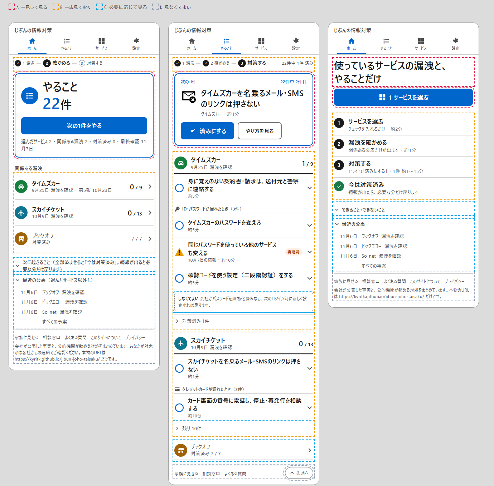

# 「どこを見るべきか」を決める注意の4段階 — 調査報告と設計案（第4弾）

作成日：2026-11-07　前提：第1〜3弾（文字・絵・全体像）は維持する。本書は「コアループに沿って、画面のすべての要素を**A 一見して見る／B 一応見ておく／C 必要に応じて見る／D 見なくてよい**の4段階に割り当て、大きさ・明度・囲い・配置で段を表す」規則を定める。
きっかけは開発者の指摘「文字の大きさにメリハリがなく、構造化されていないので、どこを見るべきか分からない」。
調査は3領域（理論と根拠／製品の実例／デザインシステムの具体値）を並行で行い、一次資料を優先した。確認できなかった点は「未確認」と明記する。

提案の見た目は [mockups/hierarchy-proposal.png](mockups/hierarchy-proposal.png)（左からホーム選択後／やること／ホーム未選択。点線の色は段の説明用で、実装には出さない）。HTML版は [mockups/hierarchy-proposal.html](mockups/hierarchy-proposal.html)。

## 1. 結論（先に要点）

1. **段は「文字の大きさ」だけでは作れない。** 現行UIは文字を5段階にしたが、箱（カード・枠・色付き背景）が1画面に5〜8個あり、どれも同じ強さで並ぶため、文字の差が打ち消されている。NN/g：「すべてを強調すれば何も目立たない」「大きい要素は1画面に最大2つ」。
2. **囲むのはAだけ。** 1画面に青枠の箱は1つ（ホーム＝状態の箱、やること＝次の1件）。Bは罫線だけの行にし、カードにしない（GOV.UK タスクリスト、NN/g「カードは一覧より走査しにくい」）。
3. **数字は1つだけ大きく。** 「残り22件」だけを44pxにし、ほかの数字（選んだサービス／関係ある漏洩／対策済み）は13pxの1行にまとめる（Few「主要指標に注意を集中」、Monitor「N exposures」、Google「盾1つ」）。
4. **弱めるときは「薄く」ではなく「小さく・下に・畳む」。** 補足は13px・#4D4D4D（白地 8.5:1）・箱なし・画面下か折りたたみ。薄いグレーは「無効」に見え、読めない（NN/g「Low-Contrast Text」、WCAG 4.5:1 はフッターにも適用）。
5. **済んだものは「色を抜く→下に送る→畳む」。** 対策済みの行は通常ウェイトの灰で事案の末尾に畳み、全部済んだ事案は一覧の末尾に1行で置く（GOV.UK「Completed＝素の文字」、Todoist／Things／Monitor の完了隔離）。
6. **「未対応」タグはやめ、○の形だけにする。** 全行に青いタグが並ぶとAと競合する。状態語は「再確認」（橙）と「対策済み」（灰文字）だけに残す（GOV.UK：要対応の行に注意を集めるため完了にタグを付けない）。
7. **工程バーはどの画面も1行の小型に統一する。** 第3弾の「ホームでは大きく」は、第1画面にA以外の大きな要素を増やすので取り下げる（NN/g「第1画面は最小限に絞る」、閲覧時間の57%が第1画面）。
8. **Dは文字リンクだけ。** 「家族に見せる／相談窓口／よくある質問」の枠付きボタン3つをフッターの文字リンクに下げる。注意書きは12px灰（DADSの「14px未満は原則不可」からは外れるが、本サイトでは注意書きに限って許容する。本文・UIには使わない）。

## 2. コアループと4段階の定義

利用者が繰り返すこと：

1. 開く → 「今、やることがあるか」を一目で知る（ホーム）
2. 次の1件をやる → 済みにする（やること）
3. 「今は対策済み」に着く
4. 続報が出る → 必要な分だけ戻る → 1へ（初回だけ 0. サービスを選ぶ）

| 段 | 定義 | ループでの役目 | 例 |
| --- | --- | --- | --- |
| **A 一見して見る** | 開いた瞬間に答えが分かるもの。1画面に「状態1つ＋主ボタン1つ」 | 1と2の答え | 「やること 22件」、「次の1件をやる」、次の1件の行動名と「済みにする」 |
| **B 一応見ておく** | Aの内訳。読まなくてもループは回る | どの事案で、何が残っているか | 事案名と件数の行、やることの行の題名、工程バーの現在地 |
| **C 必要に応じて見る** | 迷ったとき・詳しく知りたいときだけ | 判断の補助 | やり方・理由・根拠・窓口、しなくてよい、次に起きること、最近の公表、対策済みの行 |
| **D 見なくてよい** | 法的・運営上の記載と補助導線 | ループの外 | 注意書き、プライバシー等のリンク、データ生成日、家族に見せる・相談窓口 |

## 3. 現行UI（PR #13 時点）の監査

| 画面 | 要素 | 現状 | 問題 | あるべき段 |
| --- | --- | --- | --- | --- |
| ホーム | 工程バー（大） | 最上部、現在16px太字 | 答えより先に目に入る | B（1行に縮小） |
| ホーム | 状態の要約 | 32px、青枠 | 正しい | A |
| ホーム | 数字4個 | 同じ大きさの箱4つ | 4つが同格。2つはループに不要 | 残り＝A（見出し内）、他＝C（1行） |
| ホーム | 事案カード | 白カード×3、名前20px、チップ、件数、リンク | Aの直下に同じ強さの箱が並ぶ。チップが重い | B（罫線の行。チップはCへ） |
| ホーム | 次に起きること | 灰背景の箱 | 箱があるので「読むもの」に見える | C（折りたたみ、1行要約） |
| ホーム | 最近の公表 | 白カード、赤タグ | 枠と赤が目立つ。ループ外 | C（箱なし、13px、タグは文字） |
| 全画面 | 導線3ボタン | 白枠ボタン×3 | 枠付きで目立つ | D（文字リンク） |
| やること | 目次 | 白枠の箱 | 次の1件より先に箱がある | 削除（事案3つ以下）または C（文字リスト） |
| やること | 次の1件 | 青枠、22px、主ボタン | 正しい | A |
| やること | 事案の見出し | 灰背景、20px太字、件数22px | 次の1件と同じ強さ | B（下罫線2px、背景なし） |
| やること | 行 | 全行 16px太字＋青タグ「未対応」 | 全行が同格。タグ×7がAと競合 | B（太字は残し、タグは消す） |
| やること | 対策済みの行 | 一覧の中に混在 | 済んだものが要対応と同じ位置 | C（末尾に畳む） |
| やること | しなくてよい | 破線枠、14px | 枠で目立つ | C（12px灰、破線は細く） |

## 4. 根拠の要約

### 4.1 段の数と大きさ
- NN/g「Visual Hierarchy」：サイズは小・中・大の**3段階まで**、大きい要素は**最大2つ**、「すべてを強調すれば何も目立たない」。色だけに頼らない。 https://www.nngroup.com/articles/visual-hierarchy-ux-definition/
- WCAG の「大きい文字」の境界は本文の **1.2倍（太字）／1.5倍**。これより小さい差は「同じ段」に見える。 https://www.w3.org/WAI/WCAG22/Understanding/contrast-minimum.html
- 前注意的処理では**輝度差が色相差より優先**され、サイズ・輝度は200ms未満で検出される（Healey）。→ 段は「大きさ＋黒／灰」で作り、色は要対応にだけ使う。 https://www.csc2.ncsu.edu/faculty/healey/PP/
- 各デザインシステムの隣接比は1.19〜1.5（GOV.UK 16/19/24/27/32、Apple 13/15/17/20/22/28/34、Material 12/14/16/22/24/28/32）。

### 4.2 弱め方
- NN/g「Low-Contrast Text」：薄い文字は「読めない・見つからない・アクセシブルでない」。目立たせたくないなら**情報量を減らす、小さくする、下に置く、アコーディオンに入れる**。 https://www.nngroup.com/articles/low-contrast/
- WCAG 1.4.3：通常文字は **4.5:1**。フッターや補足に免除はない。白地なら #767676 が下限（4.54:1）。本サイトの灰 #4D4D4D は 8.5:1 で十分。
- GOV.UK 副文字 #484949（9:1）、NHS #4C6272、Things #86868B。「補足は灰1色、1文、リンク禁止」が共通。
- Material 3 は不透明度ではなく on-surface／on-surface-variant の**2段**で表す。Apple の secondaryLabel は白地で 3.4:1 と AA 不合格のため採らない。

### 4.3 囲いと行
- NN/g「Common Region」：境界は強い手がかりだが「念のための枠」は散らかり、全幅の帯は**偽の終端**になりスクロールを止める。 https://www.nngroup.com/articles/common-region/
- NN/g「Cards」：カードは**一覧より走査性が低く**、順位づけを弱め、場所を取る。同種の項目は縦リスト。 https://www.nngroup.com/articles/cards-component/
- GOV.UK タスクリスト：行＝名前（リンク）＋右端に状態、**1px罫線だけでカードにしない**、行全体がリンク。完了は**タグなしの素の文字**、「まだ着手できない」は灰文字。タグがボタンに見えて誤タップされたため淡色・通常ウェイトに。 https://design-system.service.gov.uk/components/task-list/
- GOV.UK Panel：確認ページ以外に**使わない**。Inset text は「目立つ要素の近くでは気づかれない」。 https://design-system.service.gov.uk/components/panel/
- Material：Outlined カードは「他より強い強調」。→ 青枠はAにだけ使う。

### 4.4 位置
- NN/g：閲覧時間の **57% が第1画面**、74% が2画面以内。折り返し直上は直下より102%多く見られる。 https://www.nngroup.com/articles/scrolling-and-attention/
- NN/g「Defer Secondary Content for Mobile」：第1画面は「最重要点を伝える最小限に絞る」「密にすると誰も読まない」。 https://www.nngroup.com/articles/defer-secondary-content-for-mobile/
- 主ボタンは1ページ1つ（GOV.UK Button、Apple HIG）。GOV.UK タスクリストでは主ボタンは**一覧の下**。
- Few：最重要指標を**左上に、ほかより大きく**。要素は7以下。

### 4.5 畳む
- GOV.UK Details：「一部の利用者だけが必要な情報」に使い、**大多数が必要な情報を隠さない**。DADS も同旨。 https://design-system.service.gov.uk/components/details/ ／ https://design.digital.go.jp/dads/components/disclosure/
- NN/g：開示は2層まで。モバイルでは折りたたみが過剰なスクロールを減らす。
- 完了の扱いは3段階が共通：**色を抜く（GOV.UK）→下に送る（Todoist）→別の場所に隔離（Things の Logbook、Monitor の Fixed タブ、1Password は0件のタイルが消える）**。

### 4.6 製品に共通する形
- A＝「状態を表す要素1つ＋CTA1つ」（Google セキュリティ診断＝盾1つ、Mozilla Monitor＝「N exposures」＋「Let's fix it」、GOV.UK 確認＝緑パネル1枚、Credit Karma＝スコア）。状態は色だけでなく形と文言を伴う。
- 要対応にだけ色を使い、済んだものは色を抜く（Things は95%無彩色、赤は超過・緊急だけ）。
- 緊急度の段は固定の見出し付きカードで表す（NHS ケアカード 青→赤）。本サイトでは「再確認」の橙だけに相当。
- D＝リンク列＋短い著作権・注意文（GOV.UK、NHS「Page last reviewed」）。

## 5. 設計案：4段階の表現規則

| 段 | 大きさ | 太さ・色 | 囲い | 位置 | 1画面の数 |
| --- | --- | --- | --- | --- | --- |
| A | 見出し 32px、最重要の数字 44px、行動名 22px、ボタン 17px | 700、黒。ボタンは青塗り | **青枠の箱1つ**（または青塗りボタン） | 工程バーの直下＝第1画面 | 箱1つ＋ボタン1つ |
| B | 17〜18px | 700、黒。補足行は13px灰 | **罫線だけ**（1px灰、事案見出しは下罫線2px黒） | Aの直下 | 制限なし |
| C | 12〜13px | 400、灰 #4D4D4D | なし。必要なら `details` か破線 | 一覧の末尾・折りたたみ内・画面下 | — |
| D | 12px | 400、灰 #4D4D4D | なし | 最下部。文字リンクの横並び | — |

- 段と段の差は最低 1.3倍（A 32 → B 17〜18 → C 13 → D 12。C と D は大きさより位置で分ける）。
- 青は「A の枠」「主ボタン」「リンク」だけ。橙は「再確認」だけ。赤は「禁止」と「緊急度1の情報」だけ。
- 灰は #4D4D4D の1色（白地 8.5:1、ダーク #B3B3B3）。これより薄い文字は使わない。
- 箱の入れ子はしない。A の箱の中に B の行を入れない。

### 5.1 ホーム（選択後）
- 工程バー（B、1行、12px。現在だけ14px太字）
- **A の箱**：アイコン＋「やること」32px／「22」44px青＋「件」／主ボタン「次の1件をやる」（→ やること画面の次の1件）／13px灰の1行「選んだサービス 2 ・ 関係ある漏洩 2 ・ 対策済み 0 ・ 最終確認 11月7日」（それぞれ押せる）
- **B の行**「関係ある漏洩」：丸＋事案名17px太字＋13px灰の補足（公表日・状態・第N報）＋「0 / 9」＋「›」。全部済んだ事案は通常ウェイト灰で末尾。チップはここに出さない（事案別ページと、やることの事案見出しに残す）
- **C**：「次に起きること」は `details`（1行要約を summary に）。「最近の公表」は箱なし13px、状態は文字
- **D**：フッターに「家族に見せる／相談窓口／よくある質問／このサイトについて／プライバシー」の文字リンク＋注意文12px

### 5.2 やること
- 工程バー（B、1行。右端に「22件中 1件 済み」）
- **A の箱**「次の 1件」：行動名22px＋13px灰の事案名・所要時間＋「済みにする」（青）＋「やり方を見る」（枠）
- **B**：事案ごとに「丸＋事案名18px太字＋13px補足＋件数」の見出し行（下罫線2px黒、背景なし）。行は○（青）＋題名16px太字＋12px灰の所要時間＋「⌄」。**「未対応」タグは出さない**。「再確認」は△橙＋橙タグ
- **C**：情報種別の小見出し12px灰、しなくてよい12px灰破線、**対策済みの行は事案の末尾に「対策済み N件」で畳む**、行数が多い事案は「残り N件」で畳む（先頭3件だけ見せる）、全部済んだ事案は一覧の末尾に1行（通常ウェイト灰）
- 目次は事案が4つ以上のときだけ、13pxの文字リストで出す（箱なし）
- **D**：フッターの文字リンク、「先頭へ」

### 5.3 ホーム（未選択）
- **A**：タグライン28px＋主ボタン「1 サービスを選ぶ」（ボタンは説明の**上**。第1画面に答えと行動を置く）
- **B**：工程3段＋終点（17px太字＋13px灰、罫線だけ）
- **C**：「できること・できないこと」と「最近の公表」は `details`
- **D**：フッター

### 5.4 サービス・設定・事案別ページ
- サービス：A＝検索欄と画面下の「決定」。B＝よく使われる上位（罫線の行に変更、カードをやめる）。C＝カテゴリ折りたたみ。
- 設定：項目見出し17px、説明13px灰、ボタンは枠線のみ（青塗りは使わない）。
- 事案別ページ：A＝見出し＋「登録する」。B＝漏れた情報のチップ、やることの行。C＝目次、くわしい内訳、会社の公表の時系列、事実のメモ。D＝訂正依頼の注記。

## 6. 既存設計との整合

- 第1弾（状態語彙）：「未対応」は語としては残し、画面では○の形と「残り N件」で示す。「再確認」「対策済み」は従来どおり。
- 第2弾（視覚言語）：塗りアイコン＋文字、状態の形、カテゴリ丸はそのまま。チップは事案別ページとやることの事案見出しに残し、ホームからは外す。
- 第3弾（全体像）：工程バー・数字・目次・折りたたみ・次に起きることは残すが、段に合わせて「大→小」「箱→文字」「常設→折りたたみ」に変える。§4.6〜4.7 の文字スケールは本書の §5 で置き換える。
- CSP・DOM API のみ・外部リソースなしの制約内で実装できる。

## 7. 実装計画（目安）

| 段階 | 内容 |
| --- | --- |
| 1 | トークン：段ごとの大きさ・色・囲いをクラス（`.tier-a/.tier-b/.tier-c/.tier-d` 相当）に整理。灰を1色に |
| 2 | ホーム：数字4個を「見出し内の1つ＋13pxの1行」へ。事案カード→罫線の行（チップなし）。次に起きること・最近の公表を折りたたみ・箱なしに。工程バーを1行に |
| 3 | やること：事案の見出しを罫線に。「未対応」タグ削除。対策済みの行を末尾に畳む。長い事案は先頭3件＋「残り N件」。目次は4事案以上のみ |
| 4 | 全画面：導線3ボタンをフッターの文字リンクに。空状態のボタンを説明の上に |
| 5 | サービス・設定・事案別ページの段の適用、ライト／ダーク確認、CLAUDE.md の画面設計とメリハリ規則の更新 |

1本の PR の規模。

## 8. 未検証・判断が必要な事項

- 「未対応」タグを消して○の形だけにすることは、CLAUDE.md の「形＋色＋文字の3点セット」から外れる。行の補足（所要時間）か見出し行の「残り N件」で文字情報を補う案で進めるが、アクセシビリティ上は `aria-label` で状態語を残す。
- 「残り N件」で先頭3件だけ見せる畳み方は、GOV.UK「大多数が必要な情報を隠さない」と緊張する。次の1件が常に先頭にあるため許容と判断したが、公開後に利用者の声で見直す。
- 12px の注意書きは DADS の「14px未満は原則不可」から外れる。注意書きに限定し、本文・UI・補足（C）は13px以上を守る。
- ホームの事案行からチップを外すと「何が漏れたか」が1タップ先になる。やることの事案見出し行に小さく残すかは実装時に確認する。

## 9. 出典（主要）

- NN/g Visual Hierarchy：https://www.nngroup.com/articles/visual-hierarchy-ux-definition/ ／ Low-Contrast Text：https://www.nngroup.com/articles/low-contrast/ ／ Common Region：https://www.nngroup.com/articles/common-region/ ／ Cards：https://www.nngroup.com/articles/cards-component/ ／ Scrolling and Attention：https://www.nngroup.com/articles/scrolling-and-attention/ ／ Defer Secondary Content：https://www.nngroup.com/articles/defer-secondary-content-for-mobile/ ／ Progressive Disclosure：https://www.nngroup.com/articles/progressive-disclosure/ ／ Accordions：https://www.nngroup.com/articles/accordions-complex-content/
- WCAG 1.4.3：https://www.w3.org/WAI/WCAG22/Understanding/contrast-minimum.html ／ 1.4.11：https://www.w3.org/WAI/WCAG22/Understanding/non-text-contrast.html
- Healey（前注意的処理）：https://www.csc2.ncsu.edu/faculty/healey/PP/
- GOV.UK Task list：https://design-system.service.gov.uk/components/task-list/ ／ Tag：https://design-system.service.gov.uk/components/tag/ ／ Panel：https://design-system.service.gov.uk/components/panel/ ／ Details：https://design-system.service.gov.uk/components/details/ ／ Button：https://design-system.service.gov.uk/components/button/ ／ Type scale：https://design-system.service.gov.uk/styles/type-scale/ ／ Colour：https://design-system.service.gov.uk/styles/colour/ ／ Confirmation pages：https://design-system.service.gov.uk/patterns/confirmation-pages/ ／ タスクリスト改善の経緯：https://designnotes.blog.gov.uk/2023/12/15/working-as-a-community-to-iterate-the-task-list-pattern/
- デジタル庁 DADS タイポグラフィ：https://design.digital.go.jp/dads/foundations/typography/ ／ カラー：https://design.digital.go.jp/dads/foundations/color/ ／ ディスクロージャー：https://design.digital.go.jp/dads/components/disclosure/ ／ アコーディオン：https://design.digital.go.jp/dads/components/accordion/
- Material 3 型スケール：https://github.com/material-foundation/material-tokens ／ 色ロール：https://github.com/material-components/material-components-android/blob/master/docs/theming/Color.md ／ Card：https://github.com/material-components/material-components-android/blob/master/docs/components/Card.md
- Apple HIG Typography：https://developer.apple.com/design/human-interface-guidelines/typography ／ Buttons：https://developer.apple.com/design/human-interface-guidelines/buttons ／ Layout：https://developer.apple.com/design/human-interface-guidelines/layout
- NHS ケアカード：https://service-manual.nhs.uk/design-system/components/care-cards ／ Do/Don't：https://service-manual.nhs.uk/design-system/components/do-and-dont-lists
- Mozilla Monitor 文言：https://github.com/mozilla/blurts-server/blob/main/locales/en/dashboard.ftl ／ Google セキュリティ診断：https://support.google.com/accounts/answer/46526 ／ 1Password Watchtower：https://support.1password.com/watchtower/ ／ Todoist Today：https://www.todoist.com/help/articles/plan-your-day-with-the-today-view-UVUXaiSs ／ Things 3 分析：https://blakecrosley.com/ja/guides/design/things
- Stephen Few：https://www.perceptualedge.com/articles/Whitepapers/Rich_Data_Poor_Data.pdf
