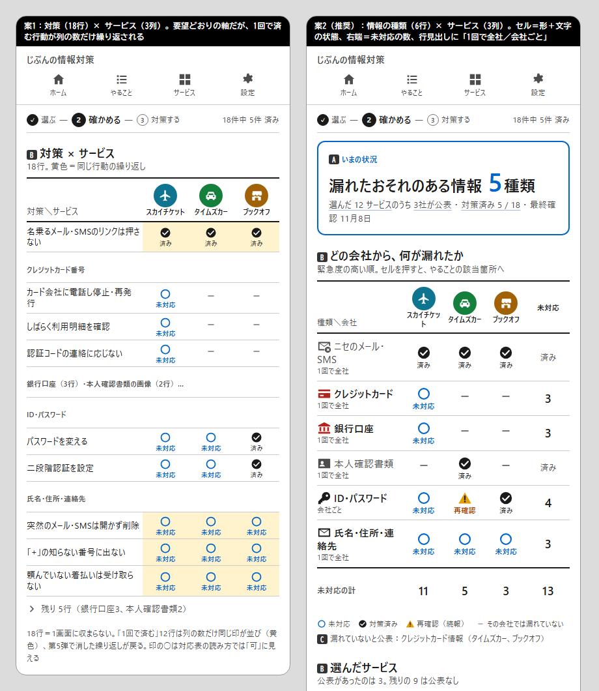

# マトリックス図（サービス × 対策）— 調査報告と設計案（第7弾）

作成日：2026-11-08　前提：第1〜6弾（文字・絵・全体像・注意の4段階・重複排除・いまの状況）は維持する。本書は「いまの状況」に **利用中サービス軸 × 対策軸の2次元マトリックス** を置けるかを検討する（開発者の要望）。
調査は3領域（表・マトリックスの設計根拠／日本での「○△×」の読まれ方／本サイトのデータでの行数・列数）を並行で行い、一次資料を優先した。確認できなかった点は「未確認」と明記する。

提案の見た目は [mockups/matrix-proposal.png](mockups/matrix-proposal.png)（左＝案1「対策×サービス」、右＝案2「情報の種類×サービス」（推奨））。HTML版は [mockups/matrix-proposal.html](mockups/matrix-proposal.html)。A〜D の札は段の説明用で画面には出ない。

## 1. 結論（先に要点）

1. **マトリックスは置く価値がある。ただし行は「対策（18行）」ではなく「情報の種類（5〜8行）」にする。** 行＝情報の種類（緊急度順）、列＝公表のあった会社（丸＋短い名前）、セル＝その会社から漏れたおそれのある種類の対策状態、右端＝その行の未対応数。3社の例で **6行×3列**、1画面に収まる。18行の対策×サービスは1画面に収まらず、第5弾で消した「1回で済む行動の繰り返し」が印として戻る（左のモック）。
2. **セルは「形＋文字」で、○△×にしない。** 日本の対応表では ◎○△× が「優・可・一部・不可」の段階評価として説明なしに通じる（英語版 Wikipedia「O mark」、笹原宏之）。本サイトの「○＝未対応」をマトリックスに置くと「可」と読まれる。セルは状態の形（○青・●✓黒・△橙・—灰）に **11pxの文字（未対応／済み／再確認）を必ず添える**（NN/g「チェックマークは単独で意味を持てない」「アイコンには常に文字ラベル」）。
3. **「1回で全社」と「会社ごと」を行見出しに書く。** 1回で済む行動（カード・口座・本人確認書類・連絡先・ニセメール）は済みにすると全列に同時に「済み」が付く。会社ごとの行動（パスワード・二段階認証）だけ列ごとに違う。この違いを行見出しの小文字（「1回で全社」「会社ごと」）で明示し、セルの結合は使わない（デジタル庁「セルの結合は最小限」）。
4. **列は4社まで横スクロールなしで入る。** 行見出し34%＋未対応列17%＋会社列3つで 360px に収まる。5社以上は表の領域内で横スクロールし、**先頭列と見出し行を固定**する（NN/g「左端の行見出し列は固定」「縦1画面を超える表は見出し行を固定」、デジタル庁「モバイルではテーブルの領域内で横スクロール」）。公表の無いサービスは列にしない（「公表なし N件」は現状どおり畳む）。
5. **置き場所は「いまの状況」の段B。** 現在の「漏れたおそれのある情報」の行（種類ごとの1行）をこのマトリックスに置き換える。会社の行（公表日・第N報・件数）と「公表なし」の折りたたみは残す。段A（N種類の箱）は変えない。
6. **数字は右端と最下行だけ。** セルに数を入れると、1回で済む行の数が列の数だけ重なり、合計が合わなくなる（3+3+3≠3）。行の未対応数を右端、会社ごとの未対応数を最下行「未対応の計」に置く（GOV.UK「数の比較は右寄せ」）。
7. **実装は `<table>`。** `<caption>`、`th scope="col/row"`、`role="region" tabindex="0" overflow:auto` の包み（Adrian Roselli、WCAG 1.4.10 Reflow）。CSS grid や div で表を組まない（Roselli「ARIA grid や div は避ける」）。

## 2. 現状と、マトリックスが足すもの

| 利用者の問い | 現状の「いまの状況」 | マトリックス |
| --- | --- | --- |
| どの会社から何が漏れたか | 種類の行に会社の丸（3つまで）。種類→会社の向きだけ | 行×列の交点で両方向に読める |
| どの会社の対策が残っているか | 会社の行の「2 / 11」 | 最下行「未対応の計」＋列を上下に見る |
| 1回で済むものと会社ごとのものの区別 | やること画面の2リスト | 行見出しの「1回で全社／会社ごと」＋全列同時に済みになる見え方 |
| 再確認（続報で戻った）がどの会社か | 種類の行の「再確認 N」 | 該当セルだけ△橙 |

例（タイムズカー・スカイチケット・ブックオフ）：行＝ニセメール（先頭カード）＋5種類＝6行、列＝3社、未対応 13。
サービスマスタ64件のうち事案があるのは23件。列は「公表のあった会社」だけなので、よく使われる上位10サービスを選んだ利用者には列が無く、マトリックスは出ない（現状の「公表された漏洩はありません」のまま）。

## 3. 根拠の要約

### 3.1 表・比較表の設計
- **NN/g Comparison Tables（Moran & Dykes, 2024-02-09）**：静的な比較表は「5項目以下」。配置は「選択肢を列、属性を行、行ラベルは左、列ラベルは上」。「チェックマークのような単独では意味を持てない記号を使うときは、行の区切りを明確に」。「セルの文は短く、できれば文にしない」。「見出し行はスクロールしても固定」。スマホでは「一度に2項目より多くは出せない」が、これは文字の多いセルの話。 https://www.nngroup.com/articles/comparison-tables/
- **NN/g Mobile Tables（Schade, 2017-09-17）**：「文字の多い表は狭い画面で2列しか入らない」が「数字中心なら狭い列でもよい」。「左端の行見出し列は固定する」「縦1画面を超える表は見出し行を固定する」「横にまだ続くことが分かるように（切れた要素が最も効く。点は気づかれにくい）」「横向きにさせるのは最後の手段」。 https://www.nngroup.com/articles/mobile-tables/
- **NN/g Icon Usability（Harley, 2014）**：「アイコンには文脈での意味を示す文字ラベルを常に添える」「ラベルは常時見える状態に」。 https://www.nngroup.com/articles/icon-usability/
- **GOV.UK Table**：「行と列で情報を比較させるときに使う」「数の比較は右寄せ」「`<caption>` を見出しのように使う」「`scope` で行見出し・列見出しを区別」。データが多いときは「減らすことを先に考える」。 https://design-system.service.gov.uk/components/table/
- **デジタル庁デザインシステム テーブル**：「データを比較するとき」に使う。「ヘッダーとデータセルは黒い罫線で区切り、ヘッダーは太字」「セルの結合は最小限」「モバイルではテーブルの領域内で横スクロール」「タッチでは Dense だと操作しにくい」「できるだけシンプルな構造」。 https://design.digital.go.jp/dads/components/table/
- **W3C WAI Tables Tutorial**：見出しは `<th>`、方向が曖昧なら `scope="col/row"`、`<caption>` で表の主題。「視覚的な手がかりだけでは不十分」。 https://www.w3.org/WAI/tutorials/tables/
- **Adrian Roselli「Under-Engineered Responsive Tables」**：`
` で包み `overflow:auto`。「ARIA grid や div で表を作らない」「display で再配置しない（意味が壊れるブラウザがある）」。 https://adrianroselli.com/2020/11/under-engineered-responsive-tables.html

### 3.2 日本での「○△×」の読まれ方
- **英語版 Wikipedia「O mark」**：日本では ◎○△× が「優秀／肯定／まあまあ・一部該当／否定」の段階を表し、○はチェックマークに相当する肯定の印。海外では通じないため凡例が要る。 https://en.wikipedia.org/wiki/O_mark
- **笹原宏之（早稲田大学）**：採点記号は漢字圏でも国によって意味や記号が異なり、万国共通と思い込むと誤解を招く。 https://japanknowledge.com/articles/blognihongo/entry.html?entryid=106
- **サイエンス社の解説**：「◎○△× は優・良・可・不可などの評価を表すが、外国語では同じ意味を持たない。各記号の意味を明記する必要がある」。 https://www.science.co.jp/en/?p=27572
- 本サイトの状態語彙（docs/ux-visual-research.md）：未対応＝○青、対策済み＝●✓黒、再確認＝△橙。**マトリックスの中では○が「可」、△が「一部」と読まれる危険がある**ので、文字を添えずに形だけで置かない。
- **マトリックス図法（新QC七つ道具）**：「二つの要素を行と列に配列し、交点に関連の有無や度合いを表示」。日本の社会人には「対応表」「L型マトリックス」として馴染みがある。交点の記号は慣習的に ◎○△ で、ここでも「○＝関連あり・良」。 https://www.edrawsoft.com/jp/new-qc-7-tools-utilization.html

### 3.3 セルに数字を入れるか
- **Graphics Interface 2020（St Andrews）**：色だけのヒートマップより「色＋数字」の方が正答率が10〜60ポイント高い。位置や速度が主目的でなければ数字の併記は有益。 https://graphicsinterface.org/wp-content/uploads/gi2020-23.pdf
- **ISPRS IJGI 2020**：地図上で比例記号より数字の方が正答が多く、応答も速い。 https://doaj.org/article/5b6a77442fa140dfb5e6d3498353abf7
- 示唆：数字は読みやすい。ただし本サイトでは「1回で全社」の行で同じ数が列の数だけ並ぶと合計が合わない。**数字は右端（行の未対応数）と最下行（会社ごとの未対応数）に置き、セルは状態の形＋文字にする**。

### 3.4 既決との関係
- 第5弾（重複排除）：行を「情報の種類」にすれば、1回で済む行動は1行のまま。案1（対策×サービス）は12行×3列に同じ印が並び、第5弾に逆行する。
- 第6弾（いまの状況）：「数字と行だけ。グラフは置かない」。マトリックスはグラフではなく表で、件数の原則（進捗は件数、％・リングなし）を守る。
- 注意の4段階：マトリックスは段B（罫線だけ、箱にしない）。段Aは1画面に1つのまま。

## 4. 設計案（案2）

### 4.1 構造
| 部位 | 内容 |
| --- | --- |
| caption／見出し | 「どの会社から、何が漏れたか」＋13px「緊急度の高い順。セルを押すと、やることの該当箇所へ」 |
| 列見出し（固定） | 会社の丸（36px）＋短い名前11px（2行まで折り返し）。並びは「要対応が多い→新しい公表」。右端に「未対応」 |
| 行見出し（固定） | 種類のアイコン（緊急度1は赤）＋種類名15px太字＋11px灰「1回で全社」または「会社ごと」。先頭は「ニセのメール・SMS」（先頭カード） |
| セル | 形＋11px文字：○青「未対応」／●✓黒「済み」／△橙「再確認」／—灰（その会社では漏れていない。読み上げは「対象外」）。高さ52px、押せる |
| 右端の列 | 行の未対応数（18px太字）。全部済みなら灰の「済み」 |
| 最下行 | 「未対応の計」：会社ごとの未対応数（1回で全社の行は各社に1回ずつ数える）と全体の数 |
| 凡例 | 表の直下に11px：○未対応 ●対策済み △再確認（続報） —その会社では漏れていない |

### 4.2 振る舞い
- セルを押す：会社ごとの行は `#/todo?go=co-<事案ID>`（会社の小見出し）、1回で全社の行は `#/todo?go=th-<種類>`。行見出しを押すのも同じ。列見出しを押すと、下の会社の行（公表日・第N報）へ。
- 列が5つ以上：表の領域内で横スクロール（`overflow:auto`、`tabindex="0"`、`role="region"`）。先頭列と見出し行は `position: sticky`。右端が切れて見えることが「続きがある」合図。
- 公表のあった会社が1社：1列の表（行見出し＋セル＋未対応数）。列が1つでも形は変えない。
- 公表のあった会社が0：表を出さない（現状の肯定文のまま）。
- ダーク：罫線・文字色はトークンに従う。状態の色は既存（青・黒・橙）。

### 4.3 やらないこと
- **対策×サービス（案1）**：18行で1画面に収まらず、繰り返しが戻る。やること画面の2リストが既にこの情報を持つ。
- **サービス×情報の種類（転置、案3）**：列見出しが「アイコン＋文字」の種類名になり、5〜8列は 360px に入らない（NN/g：文字の多い列は2列まで）。行見出しが会社名なら短いが、種類名を列に置く時点で成り立たない。
- **セルに数字**：§3.3 のとおり合計が合わない。
- **色だけ・形だけのセル**：○△が「可・一部」と読まれる（§3.2）。
- **セルの結合**（1回で全社の行を1つの横長セルにする）：会社が飛び飛びのときに結合できず、表の意味づけも壊れる（デジタル庁「結合は最小限」、W3C）。
- **グラフ化**（ヒートマップの色の濃淡）：第6弾の既決（グラフを置かない）。状態は3つしかなく、濃淡は不要。

## 5. 既存設計との整合
- 「いまの状況」の段Bの「漏れたおそれのある情報」の行を、このマトリックスに置き換える。行の持っていた「会社の丸＋公表日」は、列見出しと下の会社の行が引き受ける。
- CLAUDE.md「画面設計」の「いまの状況」の行を更新する（B＝マトリックス）。
- データ・スキーマ・ビルドの変更は無い。`summary()`／`rowsFor()` の行から、種類×事案の状態を集計できる。

## 6. 実装計画（目安）

| 段階 | 内容 |
| --- | --- |
| 1 | app.js：`matrixNode(s)`（`<table>`＋caption＋th scope＋region 包み）。種類×事案の状態（未対応／済み／再確認／対象外）と、行・列の未対応数の集計 |
| 2 | app.css：固定の先頭列・見出し行（sticky）、セルの形＋文字、横スクロールの包み、ダーク |
| 3 | 「いまの状況」の種類の行をマトリックスに置き換え。CLAUDE.md 更新。ライト／ダーク、1列・3列・5列を確認 |

1本の PR の規模。

## 7. 未検証・判断が必要な事項
- 列見出しの会社名は11pxで2行まで折り返す（「スカイチケット」は7文字で折り返す）。短縮名のデータ（`short_name`）を足すかは実装時に決める。
- 「未対応の計」で、1回で全社の行を各社に1回ずつ数える方式（3社の例：11・5・3、計13）と、全体の未対応数（13）が一致しないことの説明が要るか。最下行の右端に全体数だけを置き、会社ごとの数を「その会社に関係ある未対応」と注記する案で進める。
- 対策済みの行を灰にするか、表の末尾に下げるか。本書は「緊急度順を崩さず灰にする」を採った（表の並びが変わると位置で覚えられない）。
- 高齢者ではなく非ITの社会人が対象なので、「対応表」の読み方（○＝可）への配慮は文字ラベルで足りると判断した。利用者テストは行わない（既決）。
- NN/g・デジタル庁の資料は表一般の指針で、状態マトリックスそのものの研究は見つからなかった（ヒートマップと地図の研究で代替）。

## 8. 出典（主要）
- NN/g Comparison Tables：https://www.nngroup.com/articles/comparison-tables/ ／ Mobile Tables：https://www.nngroup.com/articles/mobile-tables/ ／ Icon Usability：https://www.nngroup.com/articles/icon-usability/
- GOV.UK Table：https://design-system.service.gov.uk/components/table/ ／ デジタル庁 テーブル：https://design.digital.go.jp/dads/components/table/ ／ W3C WAI Tables：https://www.w3.org/WAI/tutorials/tables/ ／ Roselli：https://adrianroselli.com/2020/11/under-engineered-responsive-tables.html
- O mark（Wikipedia）：https://en.wikipedia.org/wiki/O_mark ／ 笹原宏之：https://japanknowledge.com/articles/blognihongo/entry.html?entryid=106 ／ サイエンス社：https://www.science.co.jp/en/?p=27572 ／ マトリックス図法：https://www.edrawsoft.com/jp/new-qc-7-tools-utilization.html
- Graphics Interface 2020：https://graphicsinterface.org/wp-content/uploads/gi2020-23.pdf ／ ISPRS IJGI 2020：https://doaj.org/article/5b6a77442fa140dfb5e6d3498353abf7
