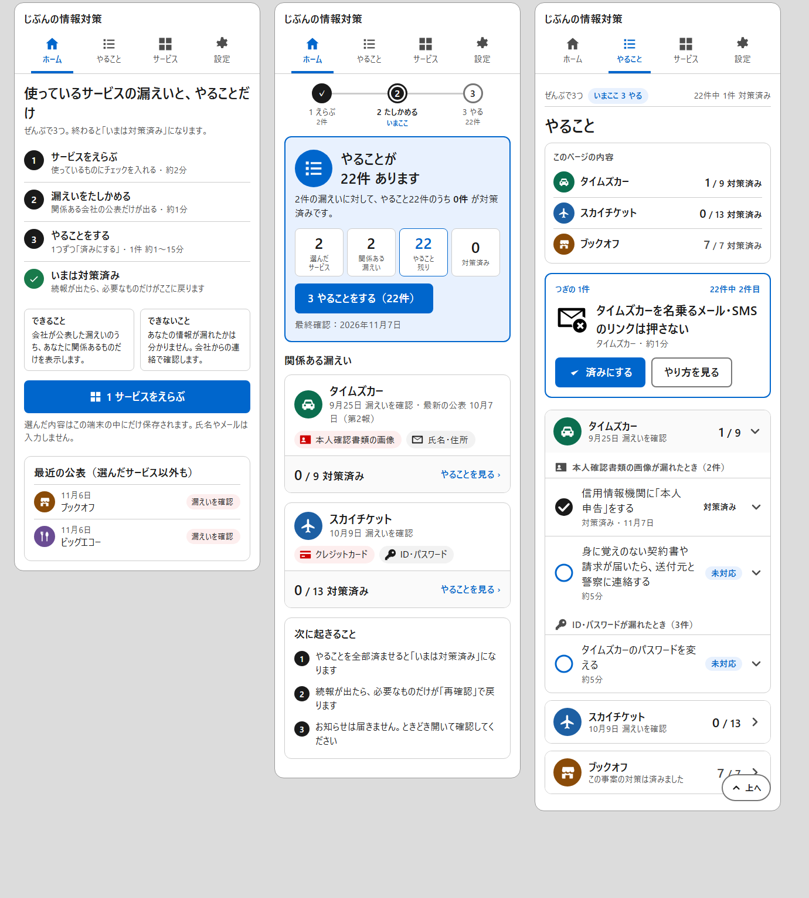

# 「全体像が理解しやすいUI」のための調査報告と設計案（第3弾）

作成日：2026-11-07　前提：第1弾 [ux-research.md](ux-research.md)（文字の設計）と第2弾 [ux-visual-research.md](ux-visual-research.md)（絵と形の設計）は維持し、本書は「全体像（旅の全体・いまの状態・一覧の中の現在地・時間の流れと終点）」の層を足す。
調査は3領域（理論と根拠／製品の実例／日本の公的サービスと高齢者）を並行で行い、一次資料を優先した。確認できなかった点は「未確認」と明記する。

提案の見た目は [mockups/overview-proposal.png](mockups/overview-proposal.png)（左からホーム未選択／ホーム選択後／やること）。HTML版は [mockups/overview-proposal.html](mockups/overview-proposal.html)（モック専用）。

## 1. 結論（先に要点）

1. **現行UIには「全体像」の4つの層のうち、2つ目（いまの数）しか無い。** 旅の全体（この道具で何が起き、どこで終わるか）、一覧の中の現在地（22行のどこにいるか）、時間の流れ（続報で戻る仕組みと、次に何が起きるか）が、文の中にしか無い。
2. **全体像は「3つの工程＋いまここ」で見せる。** 作業記憶の容量は約3〜4チャンクで、高齢者ほど保持できる数が少ない（Cowan 2010、Gilchrist 2008）。工程は「1 サービスをえらぶ／2 漏えいをたしかめる／3 やることをする」の3つに固定し、文字ラベル付きで全画面に置く（GOV.UK step by step の8ラウンド調査で完了率と自信が上昇、DADS ステップナビゲーション）。
3. **図より「見出し＋いつ何が起きるか」。** 矢印の交差や円環図は不慣れな人に「圧倒される」と評価され（arXiv 2508.04357）、年金機構やマイナンバーカードは図なしの3〜4段＋時間表現で流れを伝えている。ループ（続報で戻る）は「続報が出たら、必要なものだけがここに戻ります」の一文と日付で示す。
4. **ホームは「数字3〜4個のダッシュボード」。** 各数字は実際の画面と1対1で対応させ、タップで移動できるようにする（Baymard「進捗表示は実工程と1:1」、Few のダッシュボード定義）。グラフ・％・スコアは置かない。
5. **やること画面は「目次＋事案ごとの折りたたみ＋上へ戻る」。** NN/g のページ内リンク研究では長文で最も有効で、アコーディオンは「ページの見取り図」になる。目次には件数（「0 / 9 対策済み」）を添える。
6. **チュートリアルは作らない。** 70名の実験で、読んだ群と飛ばした群に成功率の差が無く、読んだ群のほうが「難しい」と評価した（NN/g）。代わりに「サービス未選択のホーム」を、工程一覧＋できること・できないこと＋「サービスをえらぶ」の空状態にする。
7. **終点を言葉にする。** 「対策済み」画面に「次に起きること」（続報があれば再確認が戻る／何もなければこのままで大丈夫／お知らせは届かないのでときどき開く）を常に書く（GOV.UK 確認ページ、COGA 4.6.4「完了を明確に」、免許更新の「はがきが届かなくても」）。
8. **タブの順序は据え置く。** 「旅の順にタブを並べる」直接の実証は見つからなかった。順序はホームの工程で示し、4タブ（ホーム／やること／サービス／設定）は変えない。

## 2. 現行UIの「全体像」監査

| 画面 | 現状 | 欠けている全体像 |
| --- | --- | --- |
| ホーム（未選択） | 説明文＋「サービスを選ぶ」ボタン＋最近の公表 | この道具で何が起き、どこで終わるかの工程。できること・できないこと |
| ホーム（選択後） | 看板＋流れ図（2 ▶ 2 ▶ 22）＋事案カード | 終点（対策済み）と戻り（続報）。数字が画面と対応しておらずタップできない |
| やること | 「つぎの1件」＋事案ごとの長い一覧（22行） | ページの見取り図（目次）、スクロール中の現在地、「上へ」 |
| サービス | 検索＋よく使う＋カテゴリ＋決定 | 「決定するとどうなるか」。工程の中の位置（1/3） |
| 事案別ページ | 事実＋登録ボタン＋やること全部＋公表の時系列 | 登録→反映の流れ。長い |
| ナビ | ホーム／やること／サービス／設定 | 旅の順（サービス→やること）と並びが逆。「いまどこ」の手がかりが現在タブの色だけ |

全体像には4つの層がある。(1) 道具の全体：工程と終点。(2) いまの状態の全体：数字。(3) 一覧の中の全体：目次と現在地。(4) 時間の全体：公表→続報→再確認の流れと、次に起きること。現行は (2) だけが形になっている。

## 3. 根拠の要約

### 3.1 全体像を先に見せる

- Shneiderman の「Overview first, zoom and filter, details on demand」。→ ホーム＝全体図、やること＝絞り込み、カード＝詳細、と役割を分ける。
- NN/g「You Are Here」：どこへ行けるかだけで、今どこかを示さないナビは基準点を奪う。複数の手がかりを全ページに置く。→ 工程の「いまここ」を全画面に。
- NN/g 逆ピラミッド・段階的開示：各画面の先頭に1文の状態要約。初期表示に出ているもの＝重要というシグナル。
- 高齢者と構造（Shi 2021、60〜70歳40名）：直線的階層は相互リンク型より SUS が高い（79〜90 対 59〜72）。→ 横断リンクを減らし一本道に。
- NN/g 高齢者調査：成功率 55% 対 75%、失敗時に自分を責める 90%、半数が手順メモを自作。→ 手順を常時画面に見せる。
- 先行オーガナイザー（Wolfson & Kraiger 2014）：高齢者の転移成績だけが改善。→ 冒頭に「ぜんぶで3つ。いま2つ目」。

### 3.2 工程の見せ方

- GOV.UK step by step navigation：番号付き縦リスト、並行は「and」、分岐は「or」、既定で折りたたみ。旅程内の各ページに同じ一覧を小さく再掲し現在ページを強調。8ラウンドの調査（低デジタルリテラシー含む）で完了率と自信が上昇。既知の問題は「行き来で苛立つ」。
- DADS ステップナビゲーション：「完了までに必要な作業を俯瞰し、進行状況を把握する」部品。完了＝灰丸＋チェック、現在＝黒二重丸、未着手＝白丸。待ち表示とは使い分ける。
- NN/g ウィザード：全ステップを示し現在を強調、未来は灰、ステップ数を最初に伝える。「次へ」でなく次の行動名をボタンに。
- Baymard：進捗表示は実際の工程と1対1。隠す・まとめると方向喪失。過去の段階は押せるように。
- 段数：作業記憶は約3〜4チャンク（Cowan 2010）。高齢者は保持できるチャンク数が少ない（Gilchrist 2008）。動作数が少ないほど高齢者は正確（Kim 2008）。→ 3工程。
- 図か文か：分岐を含む指示では図が正確（Kammann 1975）が、本製品の主流れに分岐は無い。不慣れな人にフロー図は「圧倒される」（arXiv 2508.04357）。高齢者には視覚だけでなく言葉を併記（Wright & Belt 2001）。
- 日本の公的サービス：マイナンバーカード「1 申請 → 2 交付通知書が届く → 3 受け取る（約1か月）」、年金機構「送付（3か月前）→ 提出 → 受け取り（1〜2か月後）」、法務省「ステップ①〜⑤」、PayPay「最短2分・審査最短当日」。各段に「いつ・どれくらい」を添える型。

### 3.3 一覧の中の現在地

- NN/g ページ内リンク：長文で最も有効。「このページの内容」とラベルを付ける。アコーディオンはページ全体の見取り図になり、モバイルの長さを緩和する。
- NN/g Back to Top：4画面分より長いページで右下に文字ラベル付きで常設。
- NN/g 固定ヘッダー：画面領域を奪うので最小限。固定するなら1行。
- Nielsen：スクロール距離は記憶に符号化できないが、番号は「栞」になる。→ 区切りごとに件数。
- GOV.UK タスクリスト（34人×5回）：全タスクを先に一覧、番号付きグループは走査が速い、チェック印は曖昧なので状態語に、Completed は黒文字。利用者は「完了したものだけ知りたい」。
- 目次の慣習：デジタル庁ページ・総務省教材は冒頭に目次。大阪市の手引きは目次から本文見出しへリンク。

### 3.4 説明とオンボーディング

- NN/g モバイルチュートリアル実験（70名）：読んだ群 91%、飛ばした群 94%、読んだ群が「難しい」と評価（p=0.047）。NN/g オンボーディング：「可能な限り作らない」。
- NN/g 空状態の3原則：状態を伝える／学習の手がかり／主要タスクへの導線。
- GOV.UK「Check a service is suitable」：始める前に該当するかを確かめさせる。開始ボタンを「始める前に」の下へ移すと読む人が増えた。
- 高齢者は説明書を好む（Leung 2011、63% 対 36%）が、専門用語だらけは嫌う。→ 常設の短い番号付き手順。
- 総務省デジタル活用支援の標準教材：「目次 → 操作の順番一覧 → 1画面1動作 → 完了の一文」の型。

### 3.5 終点と時間の流れ

- GOV.UK 確認ページ：終端に「次に何が起きるか」と「いつ」を必ず書く。
- COGA 4.6.4／4.5.10：「進行中」と「完了」を明確に。各段の終わりに完了を知らせる。
- 高齢者の安心感：心理的な統制感が速度より重要（Frontiers 2026、60歳以上285名）。フィードバックがあると高齢者の曖昧さ回避は若年者より低い（Sproten 2018）。→ 「いま、やることはありません」を肯定文で常時。
- ループは図でなく「いつ・何が届くか」で：年金の現況届「毎年誕生月に用紙が届く」、マイナンバーカード更新「2〜3か月前にお知らせ」、免許更新「はがきが届かなくても手続は必要」。→ 本製品はお知らせを送らないので「ときどき開いて確認してください」を明記。
- Mozilla Monitor：上部の要約「N exposures across M breaches」が「Your data is protected」に変わる。Google：推奨が無ければ項目が消え「no immediate action is needed」。

### 3.6 ダッシュボード

- Few：目的達成に必要な最重要情報を1画面に集約し、一目で監視できる表示。探索用ではない。
- NN/g ダッシュボード：最小の認知処理で消費できること。色は量に使わず、1点を目立たせる用途だけ。円グラフ・ゲージは避ける。
- 上位の数字は3〜4個まで（Cowan）。

## 4. 設計案：全体像の4層

### 4.1 工程バー（全画面共通。道具の全体）

- 「ぜんぶで3つ」：**1 サービスをえらぶ → 2 漏えいをたしかめる → 3 やることをする**。終点は「いまは対策済み」。
- 形は DADS ステップナビゲーション：完了＝黒丸＋✓、現在＝黒二重丸＋「いまここ」、未着手＝白丸。必ず文字ラベル。矢印は使わない（横並びの線でつなぐ）。
- ホームでは大きく（各工程に「約2分」「約1分」「1件 約1〜15分」の目安つき）。やること・サービス画面ではヘッダー直下に1行（「ぜんぶで3つ ・ いまここ 2 たしかめる」）。設定・相談窓口には出さない（旅の外）。
- 各工程は押せる（1→サービス画面、2→ホームの事案カード、3→やること画面）。Baymard の「過去の段階は押せる」に対応。

### 4.2 ホーム（いまの状態の全体）

- **未選択（空状態）**：工程一覧（3段、各段に1文の説明と目安時間）→「できること・できないこと」各2行 →「サービスをえらぶ」ボタン。ボタンは説明の下に置く（GOV.UK の知見）。チュートリアル画面は作らない。
- **選択後**：看板（大きな状態アイコン＋1文の状態要約「2件の漏えいに、やること 22件のうち 0件 対策済み」）→ 数字4個（選んだサービス／関係ある漏えい／やること 残り／対策済み。各数字をタップでその画面へ）→ 事案カード → 最近の公表。
- **対策済み**：看板「いまは対策済みです」→ 数字4個 → **「次に起きること」**3行（続報が出たら必要なものだけが「再確認」で戻る／何もなければこのままで大丈夫／お知らせは届かないので、ときどき開いて確認する）→ 最終確認日。

### 4.3 やること（一覧の中の全体）

- 先頭に「**このページの内容**」の目次：事案ごとに「カテゴリ丸＋サービス名＋0 / 9 対策済み」の行。押すとその事案へ移動。
- 事案は**折りたたみ**（`details`）。未対応がある事案は開いた状態、全部済んだ事案は閉じた状態で始める。
- 「つぎの1件」カードは目次の直後に残す（前回の設計）。
- 4画面分より長い場合、右下に「**上へ**」の文字付きボタンを常設。
- 各事案の見出し行に「0 / 9」を維持し、情報種別の小見出しに「（3件）」を添える。

### 4.4 事案カードと事案別ページ（時間の全体）

- 事案カードに「最新の公表：10月7日（第2報）」の1行を足し、続報があったことが分かるようにする。
- 事案別ページの先頭に「このページの内容」（事実／やること／会社の窓口／公表の時系列）の目次。
- 「登録する」ボタンの下に「登録すると：ホームにこの事案が出て、続報があれば やることが戻ります」の1文。

### 4.5 文言（追加）

- 工程名は動詞で短く：「えらぶ」「たしかめる」「やる」。ボタンは次の行動名（「やることを見る（22件）」）。
- 完了は肯定文：「ここまで完了です」「いま、やることはありません」。
- 1文1動作。3つ以上は箇条書き（やさしい日本語ガイドライン）。

## 5. 既存設計との整合

- 第1弾の状態語彙（未対応／対策済み／再確認）、第2弾の視覚言語（塗りアイコン＋ラベル、状態の形、カテゴリ丸）はそのまま使う。
- 進捗バー・％・祝福演出を置かない方針は維持。工程バーは「位置」を示すもので、量は件数で示す。
- CSP・DOM API のみ・外部リソースなしの制約内で実装できる（目次はページ内リンク、折りたたみは `details`、上へは `scrollTo`）。

## 6. 実装計画（目安）

| 段階 | 内容 |
| --- | --- |
| 1 | 工程バー部品（大・小）と「いまここ」。ホーム・やること・サービスに配置 |
| 2 | ホーム：空状態の作り直し、数字4個のタップ対応、対策済み状態の「次に起きること」 |
| 3 | やること：目次、事案の折りたたみ、「上へ」ボタン、小見出しの件数 |
| 4 | 事案カードの「最新の公表」、事案別ページの目次と登録の説明 |
| 5 | ライト／ダーク確認、CLAUDE.md の画面設計を更新 |

第1〜2弾と同じく1本の PR の規模。

## 7. 未検証・判断が必要な事項

- 「○件中○件」の件数表示が高齢者に効くかの直接の研究は無い（GOV.UK は語の状態表示のみ）。公開後に身近な方で確かめる。
- 工程バーを「やること」「サービス」のヘッダー直下に常設することの費用（画面領域）は NN/g の固定ヘッダーの指摘どおり。1行に限定する。
- タブの並びを旅の順にする案は実証が無く見送り。利用者の声で再検討。
- JIS Z 82079-1（使用説明の作成）の手順記述条項は本文未読（有償）。

## 8. 出典（主要）

- Shneiderman 1996（HCIL TR 96-13）：https://www.cs.umd.edu/users/ben/papers/Shneiderman1996eyes.pdf
- NN/g You Are Here：https://www.nngroup.com/articles/navigation-you-are-here/
- NN/g 逆ピラミッド：https://www.nngroup.com/articles/inverted-pyramid/
- NN/g 段階的開示：https://www.nngroup.com/articles/progressive-disclosure/
- NN/g メンタルモデル：https://www.nngroup.com/articles/mental-models/
- Shi et al. 2021（Frontiers in Psychology）：https://www.frontiersin.org/articles/10.3389/fpsyg.2021.681756/full
- NN/g 高齢者調査：https://www.nngroup.com/articles/usability-seniors-improvements/ ／ https://www.nngroup.com/articles/usability-for-senior-citizens/
- NN/g ウィザード：https://www.nngroup.com/articles/wizards/
- Baymard チェックアウト：https://baymard.com/learn/checkout-flow-ux-optimization
- GOV.UK step by step navigation：https://design-system.service.gov.uk/patterns/step-by-step-navigation/ ／ https://gds.blog.gov.uk/2018/10/17/building-a-better-gov-uk-step-by-step/
- GOV.UK タスクリスト／Complete multiple tasks／確認ページ／Check a service is suitable：https://design-system.service.gov.uk/components/task-list/ ／ https://design-system.service.gov.uk/patterns/complete-multiple-tasks/ ／ https://design-system.service.gov.uk/patterns/confirmation-pages/ ／ https://design-system.service.gov.uk/patterns/check-a-service-is-suitable/
- GOV.UK タスクリストの調査記録：https://designnotes.blog.gov.uk/2017/04/04/weve-published-the-task-list-pattern/
- デジタル庁 DADS ステップナビゲーション：https://design.digital.go.jp/dads/components/step-navigation/
- 総務省 デジタル活用支援 標準教材（マイナポータル編）：https://www.soumu.go.jp/main_content/000749815.pdf
- やさしい日本語ガイドライン（出入国在留管理庁・文化庁）：https://www.moj.go.jp/isa/content/930006072.pdf
- マイナンバーカード 申請から受け取りまで：https://www.kojinbango-card.go.jp/apprec/
- 日本年金機構 老齢年金の請求手続きの流れ：https://www.nenkin.go.jp/service/jukyu/tetsuduki/rourei/seikyu/gaiyou.html
- 年金の現況届：https://www.nenkin.go.jp/service/jukyu/tetsuduki/kyotsu/jukyu/20140421-11.html
- マイナンバーカードの有効期限：https://www.digital.go.jp/policies/mynumber/expiration-date
- 鳥取県警 免許更新：https://www.pref.tottori.lg.jp/34708.htm
- フロー図と不慣れな利用者（arXiv 2025）：https://arxiv.org/pdf/2508.04357
- Kammann 1975（Human Factors）：https://scilit.com/publications/4d379c6514788c30e82a50ea020c16e3
- Morrow et al. 1998（薬の用法アイコン）：https://experts.illinois.edu/en/publications/icons-improve-older-and-younger-adults-comprehension-of-medicatio/
- Wright & Belt 2001（Gerontechnology）：https://journal.gerontechnology.org/currentIssueContent.aspx?aid=6
- W3C COGA Making Content Usable：https://www.w3.org/TR/coga-usable/
- Cowan 2010：https://pmc.ncbi.nlm.nih.gov/articles/PMC2864034 ／ Gilchrist, Cowan & Naveh-Benjamin 2008：https://pmc.ncbi.nlm.nih.gov/articles/PMC2610466
- Kim, Bayles & Beeson 2008：https://experts.arizona.edu/en/publications/instruction-processing-in-young-and-older-adults-contributions-of/
- Wolfson & Kraiger 2014（先行オーガナイザー）：https://digitalcommons.memphis.edu/facpubs/11933
- Frontiers in Psychology 2026（高齢者の統制感）：https://www.frontiersin.org/journals/psychology/articles/10.3389/fpsyg.2026.1851466/full
- Sproten et al. 2018：https://econpapers.repec.org/RePEc:eee:soceco:v:76:y:2018:i:c:p:43-54
- NN/g ページ内リンク：https://www.nngroup.com/articles/in-page-links-content-navigation/
- NN/g Back to Top：https://www.nngroup.com/articles/back-to-top/
- NN/g 固定ヘッダー：https://www.nngroup.com/articles/sticky-headers/
- Nielsen 認知負荷：https://jakobnielsenphd.substack.com/p/cognitive-load
- NN/g チャンキング：https://www.nngroup.com/articles/chunking/
- NN/g モバイルチュートリアル：https://www.nngroup.com/articles/mobile-tutorials/ ／ オンボーディング：https://www.nngroup.com/articles/mobile-app-onboarding/
- NN/g 空状態：https://www.nngroup.com/articles/empty-state-interface-design/
- Leung et al. 2011：https://www.cs.ubc.ca/labs/edapt/papers/leung2011.pdf
- Few 2004 ダッシュボード：https://www.informationweek.com/government/dashboard-confusion-2 ／ NN/g ダッシュボード：https://www.nngroup.com/articles/dashboards-preattentive/
- NN/g モバイルナビ：https://www.nngroup.com/articles/mobile-navigation-patterns/ ／ 3つのIAの誤り：https://www.nngroup.com/articles/3-ia-mistakes/
- Mozilla Monitor 文言：https://raw.githubusercontent.com/mozilla/blurts-server/main/locales/en/dashboard.ftl
- Google セキュリティ診断：https://support.google.com/accounts/answer/46526?hl=en
- Apple セーフティチェック：https://support.apple.com/guide/personal-safety/how-safety-check-works-ips2aad835e1/web
- Duolingo パス：https://blog.duolingo.com/new-duolingo-home-screen-design/
- 大阪市「伝わるホームページ」手引き：https://www.city.osaka.lg.jp/templates/proposal_hattyuuannkenn/cmsfiles/contents/0000644/644619/02_4_tutawaruho-mupe-zi.pdf
