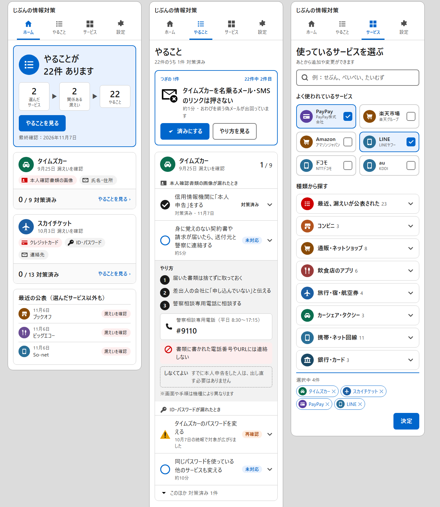

# 「視覚的に理解できるUI」のための調査報告と設計案（第2弾）

作成日：2026-11-07　前提：[docs/ux-research.md](ux-research.md)（第1弾：情報設計・文言・トークン）は維持し、本書はその上に「絵と形で伝える層」を足す。
調査は4領域（高齢者の視覚認知／類似製品の視覚表現／チェックリストの視覚パターン／CSP制約下の実装）を並行で行い、一次資料を優先した。確認できなかった点は「未確認」と明記する。

提案の見た目は [mockups/visual-proposal.png](mockups/visual-proposal.png)（左からホーム／やること／サービス）。HTML版は [mockups/visual-proposal.html](mockups/visual-proposal.html)（モック専用。本番の制約は満たしていない）。

## 1. 結論（先に要点）

1. **現行UIが「見にくい」原因は、情報の種類の違いが見た目の違いになっていないこと。** サービス・事案・漏れた情報の種類・やること・状態がすべて「同じ太さの文字の行」で、形と色の手がかりが状態ピルと小さな丸しかない。
2. **高齢者には「塗りのある具象アイコン＋文字ラベル」が決定的に効く。** 60代の視線計測で、具象アイコン＋文字の正答率 0.96 に対し、フラットな線アイコン単独は 0.40（Wu 2022）。現行の細い線アイコン単独はこの最弱条件に当たる。
3. **絵は「状態・行動・会社・情報の種類」を指すものだけに限る。** 雰囲気イラストやキャラクターは学習を妨げる（Mayer の一貫性原理、d≈0.97）。進捗リング・％・祝福演出は高齢者に罪悪感や離脱を生む報告があり、置かない。
4. **視覚言語を5つに固定する。** ①情報の種類のピクトグラム6種、②状態の形3種（○青＝未対応／●✓黒＝対策済み／△橙＝再確認）、③サービスの「カテゴリアイコン＋固定色の円」、④手順の番号丸と禁止の赤○斜線、⑤ホームの「選んだサービス → 関係ある漏えい → やること」の3段の流れ図。
5. **実装は現在の安全方針のまま可能。** HTML内インラインSVGスプライト＋同一文書 `<use>` は CSP の `default-src 'none'` と両立し、外部通信ゼロ・innerHTML不使用を維持できる。絵文字は廃止する。
6. **配色は1点だけ直す。** 現行アクセント `#0017C1` は黒との差が 1.57:1 で、加齢眼では「濃紺と黒が区別できない」（W3C）。`#0066CC`（白地 5.57:1、黒との差 3.13:1）に替える。

## 2. 現行UIの視覚監査（何が見にくいか）

スクリーンショット（第1弾実装後）を視覚要素だけで棚卸しした。

| 画面 | 視覚要素の現状 | 問題 |
| --- | --- | --- |
| ホーム | 看板は文字＋線アイコン1つ。事案は文字リンク＋赤タグ | 「何件のサービスから何件の漏えいが見つかり、やることが何件か」の関係が文で説明されており、図になっていない |
| やること | 22行が同じ見た目（○・文字・青ピル・∨）。情報種別の小見出しは灰色の小さな文字 | 種類の切れ目が見えない。「本人確認書類」「パスワード」「連絡先」の違いが形で分からない。開いた2段目も文の塊 |
| サービス | 「よく使われている」はチェックボックス＋文字。カテゴリは絵文字＋文字 | 絵文字は OS ごとに描画が違い（Windows では 🏪🏬🛒 の区別が弱い）、支援技術が「コンビニエンスストア」と二重に読む |
| 共通 | アイコンは `alert / check / check-circle / circle / search / chevron` の6種、すべて線幅2のフラット線画 | 高齢者で最も識別率が低い様式。ラベルの無い状態アイコン（○）がある |

要するに、第1弾は「読めるUI」にはなったが、「見てわかるUI」の層が無い。

## 3. 根拠の要約（領域別）

### 3.1 高齢者の視覚認知

- **画像優位性は高齢でも保たれる。** 45〜97歳の4群すべてで、線画は単語より再生・再認とも優れる（Cherry et al. 2008）。→ 行や事案に「意味のある絵」を1つ添える価値がある。
- **アイコンには常時表示の文字ラベルが必須。** 普遍的に通じるのはホーム・検索・印刷程度（NN/g）。→ アイコン単独の状態表示は作らない。
- **具象＋文字 > フラット＋文字 ≫ 具象のみ ≫ フラットのみ。** 60〜66歳・視線計測（n=15）：正答率 0.96／0.95／0.74／0.40。軽度認知障害群との差も具象＋文字で最小（Wu et al. 2022, IJERPH）。Chen et al. 2020（Applied Ergonomics）も高齢者はフラットより具象を速く正確に探索。→ **塗りのある形＋文字**にする。線だけの細いアイコンは使わない。
- **飾りの絵は害。** 無関係な語や絵を除くと学習が良くなる（Mayer、中央値 d=0.97、作業記憶の小さい人ほど効く）。広告風の帯は内容が広告でなくても見られない（NN/g バナー・ブラインドネス）。→ キャラクター・雰囲気イラスト・色付きの大きな帯は置かない。
- **近接と共通領域。** 近いものは同じ群に見え、枠や背景色はさらに強いが、多用すると雑然とする（NN/g）。カードは異種情報の束に向き、リストは同種の走査に向く。→ 事案＝カード、やること＝行。枠の二重化はしない。
- **一本道。** 60〜70歳40名で、線形階層ナビは混合階層より SUS が高い（90 対 59）。NN/g 高齢者調査では 95% が「手順どおりに進む」。→ ホーム→事案→やることの一本道を崩さない。段階的開示は2階層が限界（NN/g）。
- **加齢眼。** 青・緑が見えにくく、濃紺と黒が区別できない。80歳のコントラスト感度は20歳より約80%低い（W3C WAI 文献レビュー）。→ 濃紺アクセントと薄灰の文字をやめる。
- **色だけで伝えない。** カラーユニバーサルデザインの原則（岡部・伊藤）。推奨色：青 #0072B2、橙 #E69F00、朱 #D55E00、灰 #999999 など。多色の信号機表示は高齢者が順位付けを苦手とする。→ 状態色は「要対応（青）／要注意（橙）」の2値＋灰に留め、必ず形＋文字と組む。
- **大きさ。** WCAG 2.5.5（AAA）44px、Android 48dp。60歳以上が自分で選ぶ最小ターゲットの中央値は 13mm（Franz et al. 2019）。→ 44px は下限。行高は 64px 以上。

### 3.2 類似製品の視覚表現

| 製品 | 転用できる視覚装置 |
| --- | --- |
| Google セキュリティ診断 | 盾1つ＋緑チェック／黄赤「！」で一目の状態。全員共通リストを「あなたへの推奨だけ」に刷新 |
| Mozilla Monitor（2024） | 上部に自分の件数だけ大きく（他人の総数は削除）。1事案＝1カード（社名・日付・状態ピル・展開）。展開で「種類名：件数」の固定語彙（Email／Phone／Address／Credit Card／Password）。Fixed タブに「there's no action for you to take」。否定的トーンは理解も行動も改善しなかった |
| Have I Been Pwned 2.0 | 「Compromised Data」を種類の箇条書き、「Recommended Actions」は動詞見出し＋1文 |
| Apple セーフティチェック | 3ステップのウィザード、1画面1判断、常時「終了」 |
| GOV.UK タスクリスト | 未完了＝青タグ、Completed＝黒文字・背景なし（未完了を目立たせるため）。タグがボタンに見えた→淡色背景・濃色文字 |
| 気象庁 新防災気象情報（2026年5月） | 「数字＋色＋名称」を固定（レベル4・紫・危険警報）。色弱者と読み上げでも伝わる |
| マイナポータル | 「最初に触れるべき情報以外は表示しない」、やることページを分離 |
| 活動リング（批判） | 65歳以上で未達の「気が咎める」報告、リング圧による離脱報道 |

### 3.3 チェックリストの視覚パターン

- 4階層（サービス→事案→情報種別→やること）を画面上は「事案カード＞やること行」の2階層に圧縮し、情報種別は行左のアイコン＋小見出しで表す。
- 「次のやること」を1枚のカードで最上部に出し、直下に全体一覧を置く（GOV.UK one-thing-per-page の「自信の低い利用者に効く」と、ウィザード研究の「俯瞰を失う」欠点の両立）。進捗はバーでなく「22件中 2件目」。
- 取り消し線は読み上げられず低視力で読みにくい。薄灰ディムは高齢者に読めない。→ 対策済みは黒文字＋●✓、順序は崩さず、各事案の末尾に「このほか 対策済み N件」の折りたたみ。
- 再確認は橙＋△＋文字。赤は「確定した要対処」専用（GOV.UK は赤をエラー専用）。
- 日本では ○＝良い、×＝誤り。→ 対策済みは ✓（または○）、取り下げは「×」でなく灰の文字。禁止は赤○斜線（NHS Do and Don't の「×は do not」）。
- 行は「左：状態の形 36px／中：動詞1文＋補足／右：状態ラベル＋∨」、行全体タップ、高さ 64px 以上、間隔 8px。トグル・スワイプは不採用。
- 事案が3件以上になったら事案単位の折りたたみ（未対応ありは初期展開、複数展開可）。タブ・カルーセルは不採用（モバイルではアコーディオンが勝る、カルーセルは1枚目しか見られない）。

### 3.4 日本の公的教材の約束事

- デジタル庁 イラスト・アイコン素材の方針：1アイコン1概念、画像だけでなく文字で明記、代替テキスト必須。
- IPA 安心相談窓口だより：番号付き手順（1手順1図）、禁止文の反復、装飾イラストなし。
- 自治体のスマホ教材：用語置換（タップ→押す）、「※機種により異なります」の定型注記。
- 内閣府の警戒レベル配色は色覚検証を経て統一（色＋名称のセットで伝える）。

## 4. 設計案：5つの視覚言語

### 4.1 情報の種類のピクトグラム（6種＋2）

| キー | 形 | ラベル | 使う場所 |
| --- | --- | --- | --- |
| `credit_card` | カード（帯つき） | クレジットカード | 事案カードのチップ、やることの小見出し、行左 |
| `credentials` | 鍵 | ID・パスワード | 同上 |
| `id_document` | 顔写真つきカード | 本人確認書類の画像 | 同上 |
| `contact` | 封筒 | 氏名・住所・連絡先 | 同上 |
| `bank_account` | 柱のある建物 | 銀行口座 | 同上 |
| `my_number` | 番号の並ぶカード | マイナンバー | 同上 |
| `assets_family` | 家 | 資産・家族構成 | 同上 |
| `medical` | 十字 | 病歴・診療 | 同上（調査中の注記つき） |

- 塗り（filled）様式、24px 以上、必ず右にラベル。単独では置かない。
- 緊急度1（カード・口座・本人確認書類・マイナンバー）のチップだけ淡い赤地にして「確定した要対処」を示す。他は灰地。色は補助で、意味はラベルが担う。

### 4.2 状態の形（3種＋1）

| 状態 | 形 | 色 | ラベル |
| --- | --- | --- | --- |
| 未対応 | ○（中空の円） | 青 #0066CC | 未対応（淡青地・青文字） |
| 対策済み | ●✓（黒丸に白チェック） | 黒 | 対策済み（背景なし・黒文字） |
| 再確認 | △（橙の三角に！） | 橙 #E69F00 塗り／文字は #AC3E00 | 再確認（淡橙地） |
| 取り下げ | （形なし） | 灰 | 取り下げ（灰文字） |

形を 36px にし、行の左端に置く。色覚・読み上げ・白黒印刷のどれでも区別できる3点セット。

### 4.3 サービスの識別（ロゴなし）

- 「カテゴリの塗りアイコン＋カテゴリ固定色の円（白アイコン）＋サービス名」。13カテゴリに固定12色（状態色の青・橙・赤と衝突しない色相を選ぶ）。
- 同じ色と形が、サービス選択の枠・選択トークン・事案カード・最近の公表の行で一貫して出るので、「車の緑丸＝タイムズカー」と覚えられる。
- 先頭文字アバター（「タ」）は同音衝突が多く高齢者での根拠が無いため採用しない。ロゴ・ブランド色は商標上の理由で引き続き使わない。

### 4.4 手順の図式（やることを開いたとき）

- 手順は番号丸①②③で縦に並べる（IPA の「1手順1図」に将来対応できる形）。
- 電話番号は電話アイコン＋24px の太字で枠に入れる。
- 「〜しない」は赤○斜線＋淡赤地の1行。「しなくてよい」は破線枠＋灰文字（×を使わない）。
- 末尾に「※画面や手順は機種により異なります」を定型で添える。

### 4.5 ホームの流れ図

「選んだサービス 2 ▶ 関係ある漏えい 2 ▶ やること 22」の3段の箱を看板の中に置く。これが企画書の価値の中心（サービス選択 × 事案DB × やること）そのものを図にしたもので、「なぜ22件なのか」を文で説明しなくてよくなる。看板の左には状態を表す大きな丸アイコン（未対応あり＝青のリスト、対策済み＝黒のチェック、未選択＝灰のサービス）。数字と矢印だけで、進捗バーや％は置かない。

### 4.6 画面ごとの変更点（モック対応）

- **ホーム**：看板（大アイコン＋見出し＋流れ図＋ボタン）→ 事案カード（カテゴリ丸＋社名＋日付・状態／漏れた情報チップ／「0 / 9 対策済み」）→ 最近の公表（カテゴリ丸つき3件）。
- **やること**：「つぎの1件」カード（大きな絵＋動詞見出し＋「済みにする」「やり方を見る」＋「22件中 2件目」）→ 事案カード（ヘッダに「1 / 9」）→ 情報種別の小見出し（アイコン＋ラベル）→ 行（形＋文＋ラベル）→ 開いた2段目（番号手順・電話・禁止・しなくてよい）→ 「このほか 対策済み N件」。
- **サービス**：検索はそのまま。よく使われているサービスはカテゴリ丸つきの2列カード、選択済みは青枠＋青地＋✓。カテゴリ行は絵文字をやめカテゴリ丸に。選択トークンにも小さなカテゴリ丸。
- **ヘッダ**：4つの導線に塗りアイコン（家・一覧・格子・歯車）を文字の上に置く。現在地は青＋下線。
- **設定・相談窓口・FAQ**：構造は変えず、見出しにアイコンを添える程度。

## 5. トークンの変更

| 項目 | 現行 | 提案 | 根拠 |
| --- | --- | --- | --- |
| アクセント（ライト） | #0017C1（黒との差 1.57:1） | #0066CC（白地 5.57:1、黒との差 3.13:1、淡青地 #E8F1FE 上 4.89:1） | W3C「濃紺と黒が区別できない」。文字 AA と非文字 3:1 を両方満たす |
| 再確認の塗り | 橙系の文字のみ | 形の塗り #E69F00（黒文字との差 7.73:1）、文字は #AC3E00 維持 | Okabe-Ito 橙、色弱でも青と区別 |
| 状態アイコン | 線幅2の線画 1.25em | 塗りの形 36px | Wu 2022 |
| 行の高さ | 自動（約56px） | 64px 以上、間隔 8px | Android 48dp＋間隔 8dp、本文18px |
| アイコン一般 | 線画 | 塗り、24px 以上、ラベル併記 | Wu 2022、NN/g |
| ダーク | 変更なし | アクセント #9DB7F9 維持。塗りアイコンは currentColor で反転 | — |

## 6. 実装方針（安全方針を変えない）

1. **アイコンの供給**：Lucide（ISC）を主、不足分を Tabler（MIT）の filled で補う。約30個を `assets/icons/<id>.svg` に置き、`build.mjs` が `<svg hidden><symbol id="i-<id>" viewBox="0 0 24 24">…</symbol></svg>` として各 HTML の `<body>` 先頭に出力する。ライセンス全文は `THIRD_PARTY_NOTICES.md` に同梱（UI 表記は不要）。
2. **描画**：`src/app.js` は `createElementNS` で `<svg class="icon"><use href="#i-<id>"/></svg>` を作る。`<use>` の `href` は Trusted Types の対象外で、同一文書参照はどの CSP ディレクティブにも掛からない（MDN／CSP3）。外部スプライト（`icons.svg#x`）は Firefox 131 以前で遮断されるため使わない。`mask-image` の data: URI も `img-src 'self'` で遮断されるため使わない。
3. **色**：`stroke`／`fill` は `currentColor` のまま、CSS クラスで色を付ける（`style=` 属性不要）。
4. **データ**：`data/services.json` の `categories[].icon` を絵文字からアイコンID（`"store"` など）に替え、`color` キーで固定色を持たせる。`data/cards.json` の `info_types[]` に `icon` を追加。
5. **検査**：`check-dist.mjs` に「`<use href>` は `#` 始まりのみ」「`<svg>` 内に `style=` 無し」「絵文字（U+1F000 以降）が HTML に無い」を追加。`validate.mjs` に `icon` の存在確認を追加。
6. **容量**：`<symbol>` 1個 150〜300B、30個で約 6〜9KB（gzip 2〜3KB）。イラスト（人物など）は MVP では入れない。入れる場合は CC0（Open Peeps）かデジタル庁素材のみ。日本語の無料素材サイトは公開リポジトリへの同梱が規約上グレーなので入れない。
7. **動き**：済みにしたときの ✓ は 150ms 程度の線描画のみ（外部 CSS の `@keyframes`、`prefers-reduced-motion` で無効）。紙吹雪・リング・音は置かない。
8. **長い一覧**：サービス一覧と事案一覧に `content-visibility: auto`（Baseline 2024。非対応ブラウザでは無視されるだけ）。

## 7. 実装計画（目安）

| 段階 | 内容 | 規模 |
| --- | --- | --- |
| 1 | アイコン素材の取り込み・スプライト生成・NOTICES・check-dist 追加 | build.mjs、check-dist.mjs、assets/ |
| 2 | トークン更新（アクセント #0066CC、状態の形、行高） | app.css |
| 3 | やること：状態の形、情報種別の小見出し、「つぎの1件」カード、2段目の図式、対策済みの折りたたみ | app.js、app.css |
| 4 | ホーム：看板の流れ図、事案カード、最近の公表のカテゴリ丸 | app.js、app.css |
| 5 | サービス：絵文字廃止、カテゴリ丸、選択カード、トークン | services.json、app.js、app.css |
| 6 | ヘッダのアイコン、事案別静的ページへの同じ視覚言語の適用、ライト／ダークの確認 | build.mjs、app.css |

第1弾と同じく1本の PR にまとめられる規模。事案データの事実項目は変えない。

## 8. 未検証・判断が必要な事項

- 高齢者での検証は行っていない（開発者判断で非実施）。公開後に身近な方の反応で、特に「流れ図」と「つぎの1件」の2点を確かめるのがよい。JIS Z 8212（図記号の理解度試験、2025年制定）の手順を簡略化し、アイコンの意味を答えてもらう方法がある。
- 盾・家・傘などの「安心」メタファーが日本の高齢者に通じるかの研究は見つからなかったため、記号より「いまは やることが ありません」の文を主役にしている。
- 先頭文字アバター、文字アバター全般の高齢者での識別性は未確認（不採用の理由の一つ）。
- デジタル庁 イラスト・アイコン素材の zip の中身（SVG の有無）は未確認。使う場合は加工内容の明示が要る。
- Safari で外部 `<use>` と CSP がどう扱われるかは未確認（インライン化するので影響なし）。
- 出典バッジ（IPA・警視庁のロゴを根拠リンクに添える案）はロゴ利用条件が未確認のため見送り。

## 9. 出典（主要）

- Wu et al. 2022, "Icon Design for Older Adults" IJERPH：https://pmc.ncbi.nlm.nih.gov/articles/PMC9026834/
- Chen et al. 2020, Applied Ergonomics（具象 vs フラット）：https://flatisbad.com/publications/Chen-ApplErgon20.pdf
- Cherry et al. 2008, Memory（画像優位性と加齢）：https://repository.lsu.edu/psychology_pubs/1101
- NN/g Icon Usability：https://www.nngroup.com/articles/icon-usability/
- NN/g Minimize Cognitive Load：https://www.nngroup.com/articles/minimize-cognitive-load/
- NN/g Banner Blindness：https://www.nngroup.com/articles/banner-blindness-old-and-new-findings/
- NN/g Gestalt Proximity／Common Region：https://www.nngroup.com/articles/gestalt-proximity/ ／ https://www.nngroup.com/articles/common-region/
- NN/g Cards Component：https://www.nngroup.com/articles/cards-component/
- NN/g Progressive Disclosure／Accordions／Tabs／Carousels：https://www.nngroup.com/articles/progressive-disclosure/ ／ https://www.nngroup.com/articles/accordions-complex-content/ ／ https://www.nngroup.com/articles/tabs-used-right/ ／ https://www.nngroup.com/articles/designing-effective-carousels/
- NN/g Usability for Senior Citizens：https://www.nngroup.com/articles/usability-for-senior-citizens/
- NN/g Wizards：https://www.nngroup.com/articles/wizards/
- Mayer 一貫性原理：https://www.cambridge.org/core/books/multimedia-learning/coherence-principle/4E80B70CB76E2166B76E5653EBDE7D3E
- Frontiers in Psychology 2021（高齢者とナビ階層）：https://www.frontiersin.org/journals/psychology/articles/10.3389/fpsyg.2021.681756/full
- W3C WAI 高齢者文献レビュー：https://www.w3.org/WAI/older-users/literature/
- WCAG 2.2 Target Size：https://www.w3.org/WAI/WCAG22/Understanding/target-size-minimum.html
- Franz et al. 2019（高齢者のターゲットサイズ）：https://faculty.washington.edu/wobbrock/pubs/assets-19.06.pdf
- カラーユニバーサルデザイン（岡部・伊藤）：https://jfly.uni-koeln.de/color/
- 高齢者と多色トラフィックライト：https://www.ncbi.nlm.nih.gov/pmc/articles/PMC4555164/
- 取り消し線の問題：https://tempertemper.net/blog/be-careful-with-strikethrough
- GOV.UK one thing per page／Task list／Complete multiple tasks：https://designnotes.blog.gov.uk/2015/07/03/one-thing-per-page/ ／ https://design-system.service.gov.uk/components/task-list/ ／ https://design-system.service.gov.uk/patterns/complete-multiple-tasks/
- NHS Do and Don't lists：https://service-manual.nhs.uk/design-system/components/do-and-dont-lists
- Mozilla Monitor 文言・設計調査：https://raw.githubusercontent.com/mozilla/blurts-server/main/locales/en/dashboard.ftl ／ https://blog.mozilla.org/ux/wp-json/wp/v2/posts/4349
- Google セキュリティ診断の刷新：https://www.blog.google/technology/safety-security/new-security-protections-tailored-you/
- Have I Been Pwned 2.0：https://www.troyhunt.com/have-i-been-pwned-2-0-is-now-live/
- Apple セーフティチェック：https://support.apple.com/guide/personal-safety/how-safety-check-works-ips2aad835e1/web
- 気象庁 新防災気象情報：https://www.jma.go.jp/jma/kishou/books/hakusho/2026/index3.html
- マイナポータル事例（デジタル庁）：https://www.digital.go.jp/resources/user-centered-approach-guidebook/case-study/mynaportal
- 活動リングと高齢者：https://pmc.ncbi.nlm.nih.gov/articles/PMC6473213/ ／ https://fortune.com/well/2025/01/24/apple-watch-bullied-burn-calories-close-rings-obsession-fitness-trackers-notifications/
- デジタル庁 イラスト・アイコン素材と利用規約：https://www.digital.go.jp/policies/servicedesign/designsystem/Illustration_Icons ／ https://www.digital.go.jp/policies/servicedesign/designsystem/Illustration_Icons/terms_of_use
- IPA 安心相談窓口だより（偽セキュリティ警告）：https://www.ipa.go.jp/security/anshin/attention/2024/mgdayori20241119.html
- 内閣府 警戒レベル配色：https://www.bousai.go.jp/pdf/200529_haishoku.pdf
- JIS Z 8211／8212（図記号、2025年1月制定）：https://www.meti.go.jp/policy/economy/hyojun-kijun/jiskouji/20250120001.html
- ○と×の日本での意味：https://www.nippon.com/en/guide-to-japan/cs00032/maru-and-batsu-circles-and-crosses-for-saying-yes-and-no.html
- CSP と SVG：https://developer.mozilla.org/en-US/docs/Web/HTTP/Reference/Headers/Content-Security-Policy/img-src ／ Firefox Bug 1773976 https://bugzilla.mozilla.org/show_bug.cgi?id=1773976 ／ CSP3 https://w3c.github.io/webappsec-csp/
- Trusted Types のシンク：https://developer.mozilla.org/en-US/docs/Web/API/Trusted_Types_API
- アイコンのライセンス：https://lucide.dev/license ／ https://github.com/tabler/tabler-icons/blob/main/LICENSE ／ https://github.com/phosphor-icons/core/blob/main/LICENSE
- 絵文字をアイコンに使わない設計システム：https://styleguide.dynatrace.com/docs/style/emoji ／ https://github.com/notofonts/noto-fonts/issues/600
- 中空 vs 塗りアイコン（Viget）：https://www.viget.com/articles/are-hollow-icons-really-harder-to-recognize-a-research-study/
- content-visibility：https://developer.mozilla.org/en-US/docs/Web/CSS/content-visibility
